# 🧾 ABRIDOR

🗨️ [português](README.md) · **English** · [español](README.es.md)

⚡ After Effects extension to speed up building the layouts of an opening sequence ⚡

**ABRIDOR** reads **PPTX** and **PDF** files directly — no conversions, no external websites — and rebuilds each page/slide as an After Effects comp, with the texts as faithful as possible to the original: position, alignment, size, leading, color, rotation and fonts. The document fonts can be swapped for others, with a preview, **before or after** creating the comps.

<p align="center">
  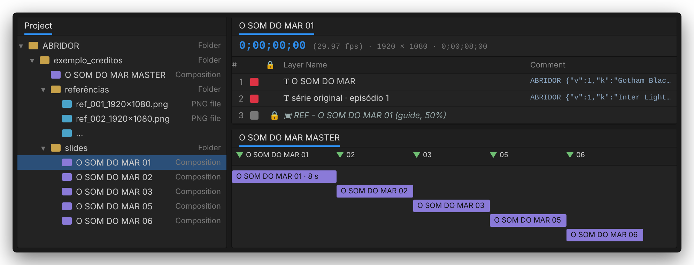
  <br><sub><i>illustration: what ABRIDOR creates in the project — one comp per page, the master comp in sequence and the references.</i></sub>
</p>

<br>

## 📑 contents

1. [install](#1--install)
2. [open the panel](#2--open-the-panel)
3. [open the document](#3--open-the-document)
4. [choose the pages](#4--choose-the-pages)
5. [set up the comps](#5--set-up-the-comps)
6. [match the fonts](#6--match-the-fonts)
7. [create the comps](#7--create-the-comps)
8. [swap the fonts later](#8--swap-the-fonts-later)
9. [tips and common issues](#-tips-and-common-issues)
10. [how the texts are recreated](#-how-the-texts-are-recreated)
11. [languages and translations](#-languages-and-translations)

> 📂 **files:**\
> • **INSTALAR O ABRIDOR.jsx** → installer (runs inside After Effects; the name is Portuguese for "install ABRIDOR").\
> • **abridor-cep/** → the extension (CEP panel).\
> • **instalar_windows.bat** / **instalar_mac.command** → alternative installers, without opening After Effects.\
> • **test files/exemplo_creditos.pptx** → sample PPTX for testing (it's the one used in the screenshots below).

<br>

---

<br>

## 1 · install

> ✅ **requirements:** After Effects **2020 (17.0)** or newer. **2024 (24.3)** or newer is recommended — see the [versions table](#-after-effects-versions).

**1.1** in After Effects, open `File` > `Scripts` > `Run Script File...` and choose **INSTALAR O ABRIDOR.jsx** straight from the ABRIDOR folder (the folder that has `abridor-cep` inside it).

**1.2** the installer checks what's needed on its own. **if everything is fine**, it opens right away with the welcome, the *✓ all good!* notice and the **install** button (or **update** / **reinstall**, if there's already a version on the computer; **remove** uninstalls). the screen shows where the extension will be copied from and to.

<table>
  <tr>
    <td align="center">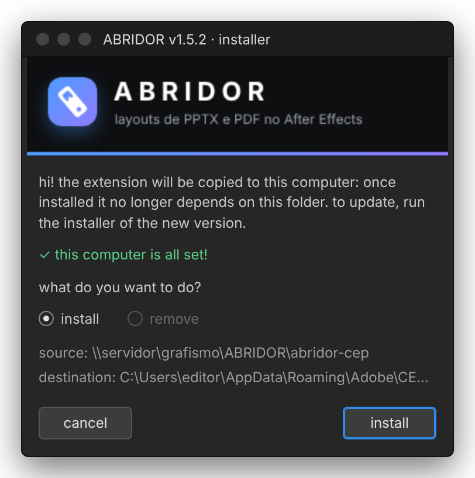<br><sub>1.2 · all good: just install</sub></td>
  </tr>
</table>

**1.3** if something needs attention, the installer opens with the welcome — click **start** — and shows the check: dot 🟢 = ok, 🟡 = works with limitations, 🔴 = needs fixing. if file writing is blocked, use the **› open scripting and expressions preferences** link, check *Allow Scripts to Write Files and Access Network* and click **› check again**. then **next** takes you to the same install / update choice.

<table>
  <tr>
    <td align="center">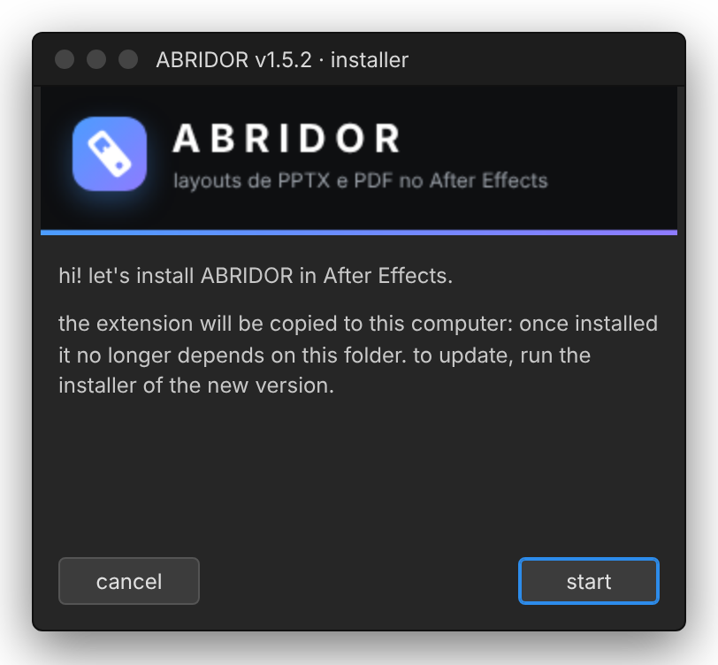<br><sub>1.3 · welcome</sub></td>
    <td align="center">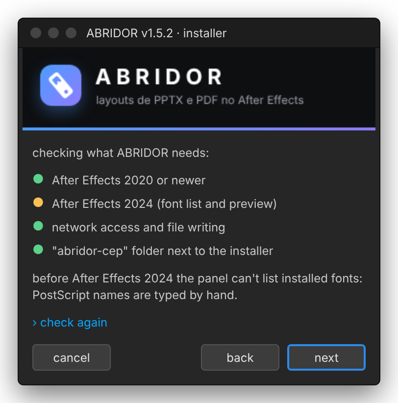<br><sub>1.3 · check</sub></td>
  </tr>
</table>

**1.4** done! **restart After Effects**.

<table>
  <tr>
    <td align="center">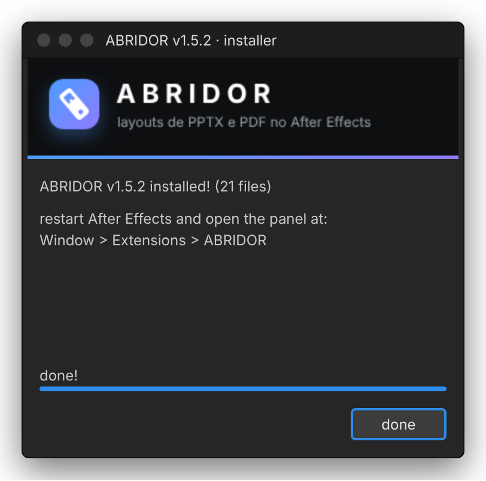<br><sub>1.4 · finished</sub></td>
  </tr>
</table>

<sub><i>illustrations of the installer window.</i></sub>

> 🚩 *note:*\
> • the installation is **always local**: the whole `abridor-cep` folder is copied to the user's extensions folder. after that, ABRIDOR no longer depends on the source folder (network, USB drive or download). to update, run the installer of the new version.\
> • the extension isn't signed, so the installer turns on CEP's `PlayerDebugMode`.\
> • **macOS:** if the panel doesn't show up after restarting After Effects, restart the computer.

<br>

---

<br>

## 2 · open the panel

**2.1** in After Effects, open `Window` > `Extensions` > `ABRIDOR`. the panel can be docked anywhere in the workspace, like the other panels. it adapts to the space: when narrow, it shows the essentials in one column; when wide, the **comps** tab switches to two columns.

<p align="center">
  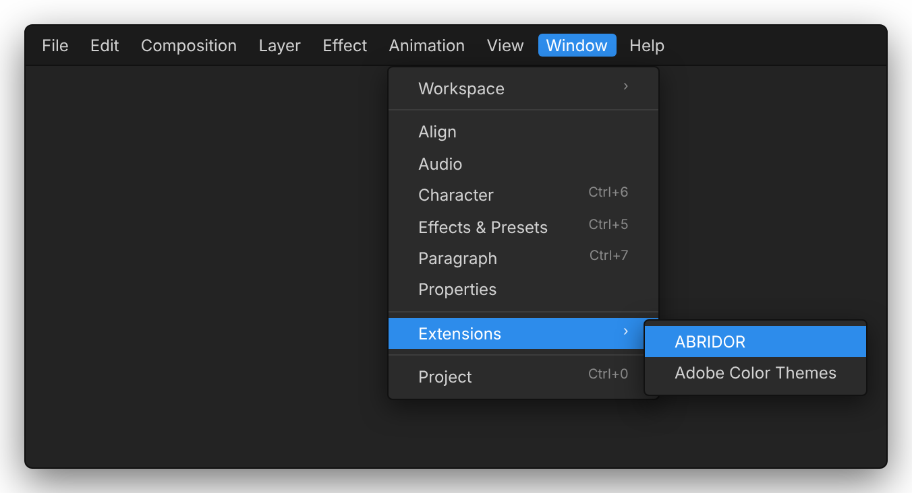<br>
  <sub><i>illustration of the After Effects menu.</i></sub>
</p>

**2.2** the panel opens ready to receive a document:

<table>
  <tr>
    <td width="400">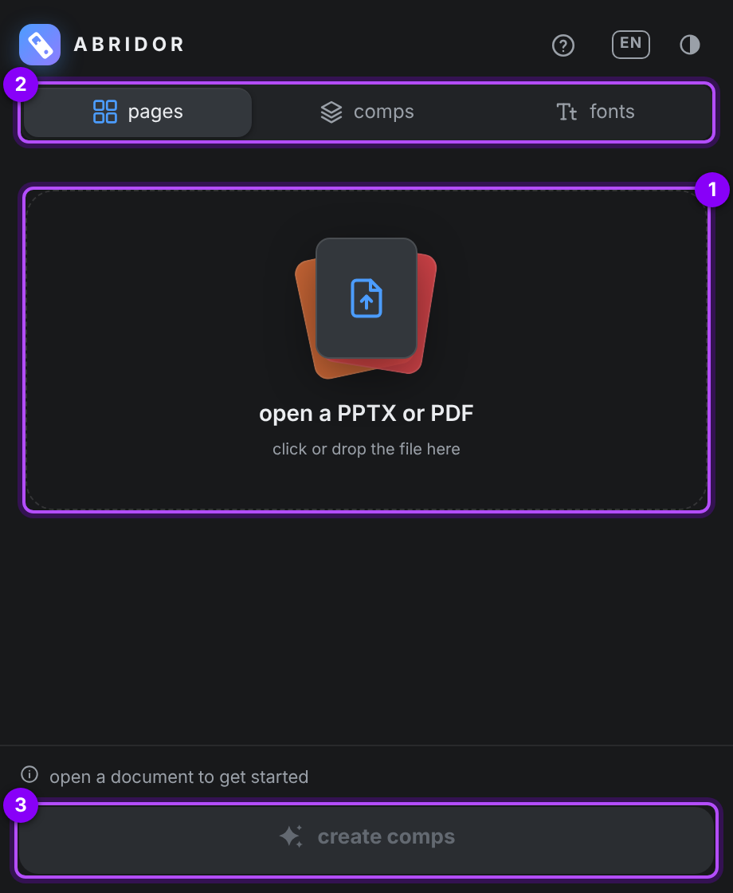</td>
    <td>

1. **click** the area or **drag** a `.pptx` / `.pdf` into the panel (shortcut: `Ctrl/Cmd + O`).
2. **tabs** → `pages`, `comps` and `fonts`.
3. **create comps** → becomes active after you open a document.

  </td>
  </tr>
</table>

<p align="center">
  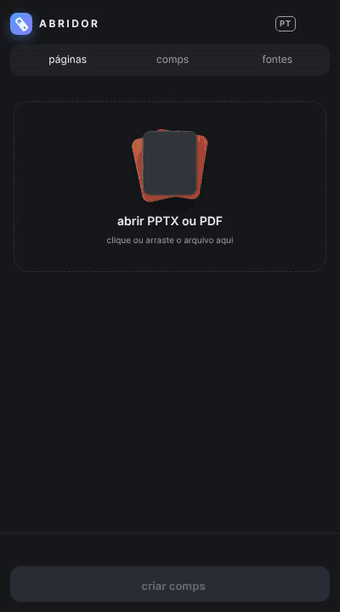<br>
  <sub>the panel in action: page selection, duration, format, fonts and creation.</sub>
</p>

**2.3** the first time you open a document, the panel offers a 5-step **guided tour**, using the document itself: pages, duration, format, fonts and the create button. `→` / `Enter` go forward, `←` goes back, `Esc` skips. to see it again later, click the **?** at the top.

<table>
  <tr>
    <td align="center">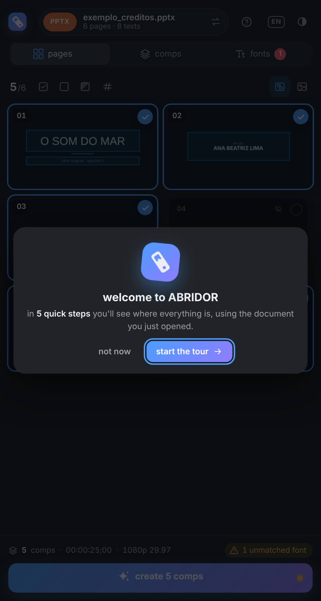<br><sub>welcome</sub></td>
    <td align="center">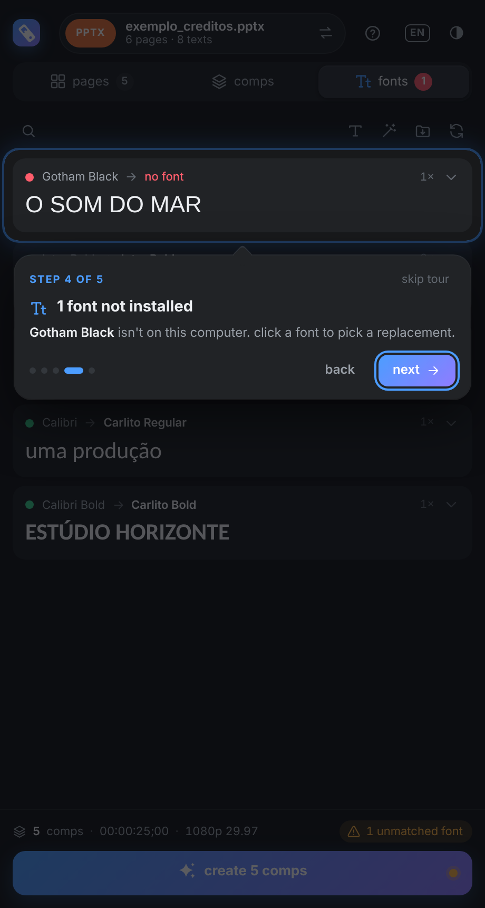<br><sub>step 4: the fonts missing in this document</sub></td>
  </tr>
</table>

**2.4** hover over any button to see the **tooltip**: what it does and, when there is one, the keyboard shortcut. on the thumbnails, the tooltip lists the texts found on the page.

<p align="center">
  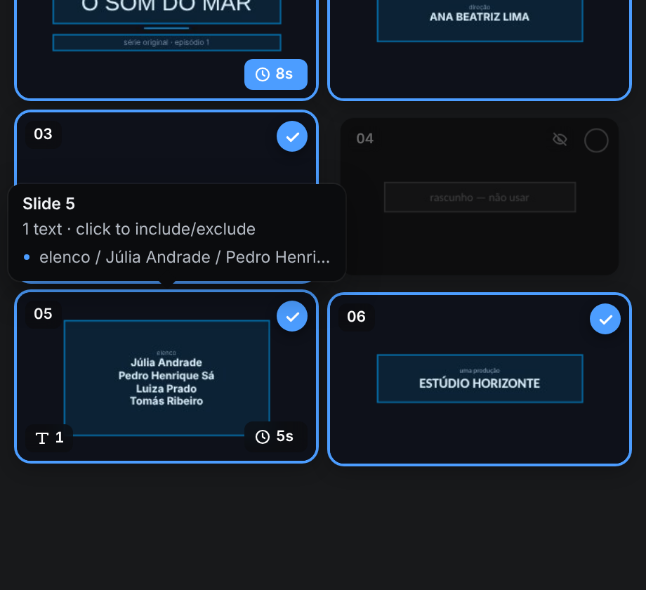
</p>

shortcuts: `Ctrl/⌘ + O` opens a document · `1` `2` `3` switch tabs · `Ctrl/⌘ + Enter` creates the comps · `↑` `↓` change the duration.

**2.5** the panel has a **light and dark theme**. the button in the top right corner cycles between:

<p align="center">
  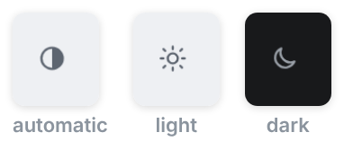
</p>

- **automatic** (default) → follows the brightness of the After Effects interface (`Preferences` > `Appearance`) and changes along if you adjust AE;
- **light** or **dark** → fixed, regardless of After Effects.

<table>
  <tr>
    <td align="center">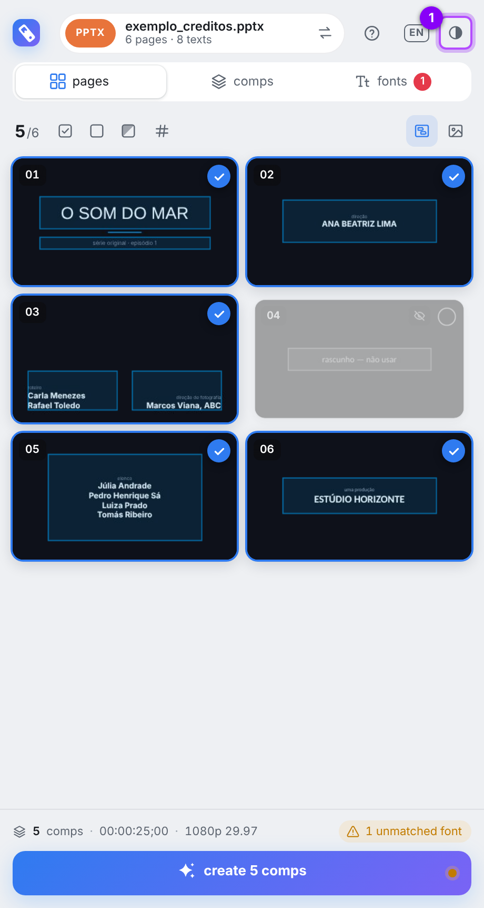<br><sub>light theme: pages</sub></td>
    <td align="center"><br><sub>light theme: fonts</sub></td>
  </tr>
</table>

**2.6** the **PT / EN / ES** button next to the theme button changes the panel language: **português → English → español**. the change is instant, without closing the open document, and it's remembered. the first time, the panel follows the After Effects language. see [languages and translations](#-languages-and-translations) to fix texts or add another language.

<br>

---

<br>

## 3 · open the document

**3.0** the empty screen lists the **recent** documents: click to reopen. files that have moved appear grayed out (the **×** removes one from the list; **clear** empties the list without deleting files).

<p align="center">
  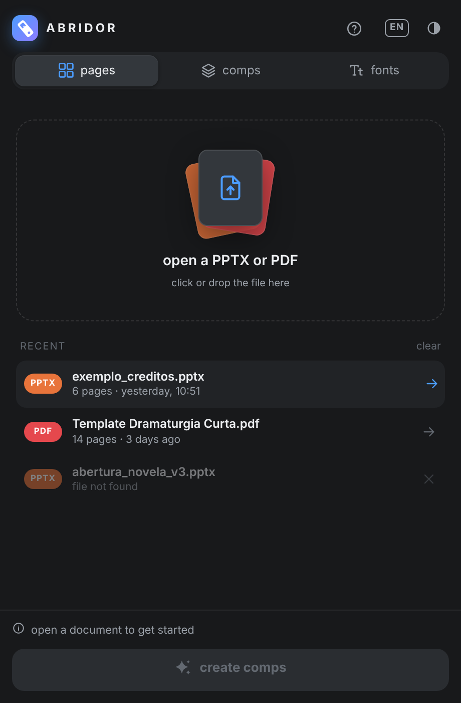
</p>

**3.1** each page appears as a thumbnail, with the detected texts highlighted on top.

<table>
  <tr>
    <td align="center">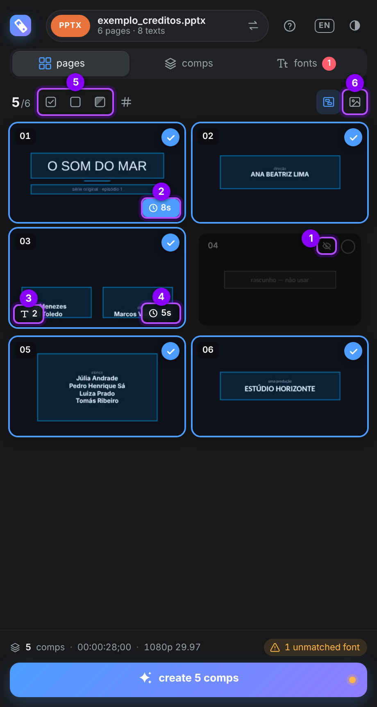<br><sub>PPTX: <code>exemplo_creditos.pptx</code></sub></td>
    <td align="center">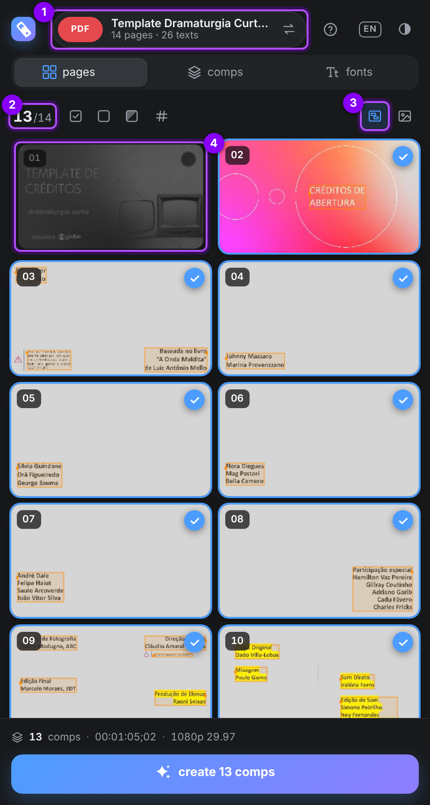<br><sub>PDF: credits template</sub></td>
  </tr>
</table>

in the **PPTX** (left):

1.  slides **hidden** in PowerPoint come already **unchecked**.
2.  **duration of this page** → in blue when it has been changed (here, 8 s).
3.  **texts detected on this page** (shown on hover).
4. the default duration also shows on hover — click to change it.
5. quick selection: **select all**, **clear selection** and **invert selection**.
6.  **external images** → uses PNG/JPG exported from PowerPoint as reference (see [tips](#-tips-and-common-issues)).

in the **PDF** (right):

1. the open document. click it to **open another document**.
2. selected pages / total.
3.  turns the text highlight on/off: 🟦 **blue** = text box, 🟧 **orange** = point text.
4. page 1 was **unchecked** with one click: its title is an **image** inside the PDF (only the "globe" is text).

**3.2** each highlight becomes **one text layer**. below, the same detection at full size, with the font, size and alignment ABRIDOR read from each block:

<p align="center">
  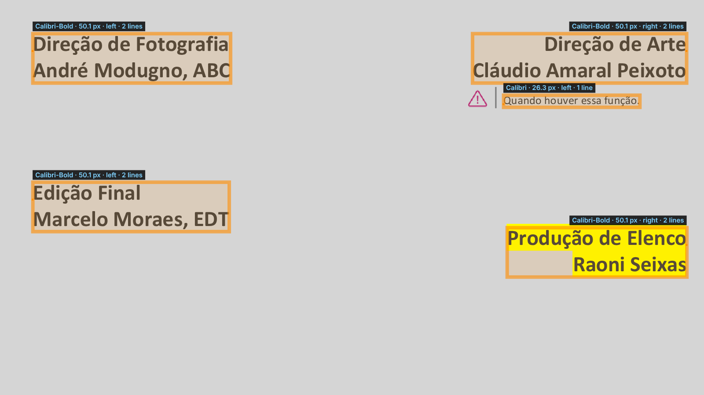<br>
  <sub>PDF: left and right blocks detected from the geometry of the lines, with the exact font and size of each one.</sub>
</p>

<table>
  <tr>
    <td align="center">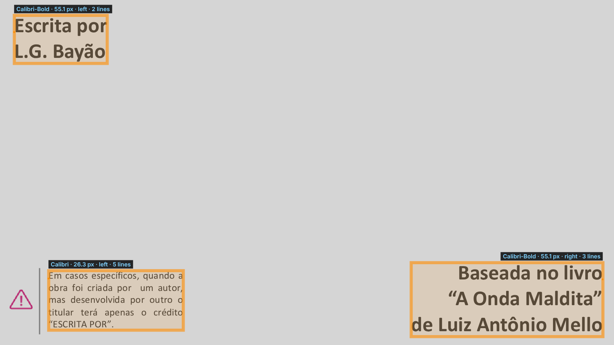<br><sub>PDF: multi-line paragraphs grouped into one layer.</sub></td>
    <td align="center"><br><sub>PPTX: PowerPoint boxes (aligned to the bottom, left and right).</sub></td>
  </tr>
</table>

<br>

---

<br>

## 4 · choose the pages

**4.1** click the **thumbnail** to include or exclude the page: the selected one gets a blue border and ✔; the excluded one is grayed out and doesn't become a comp.

hold **shift** and click another thumbnail to check or uncheck **the whole range** between the two. with shift held down, the panel already shows the range before you click:

<p align="center">
  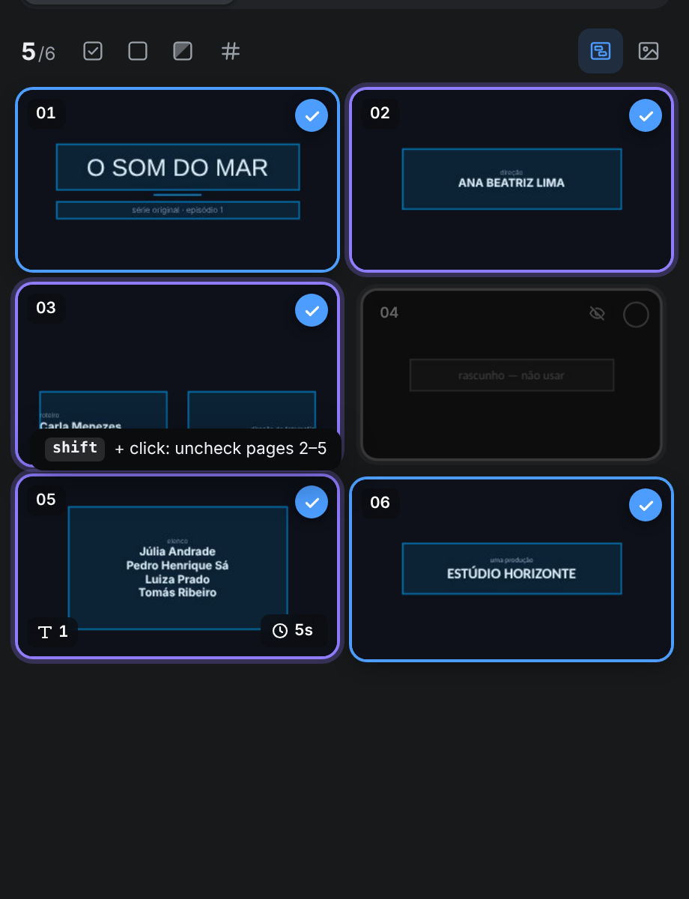
</p>

**4.2** to change the **duration of a page**, click the clock, type the seconds (decimals allowed: `6.5`) and press `Enter`. leave it empty to go back to the default duration; `Esc` cancels.

<p align="center">
  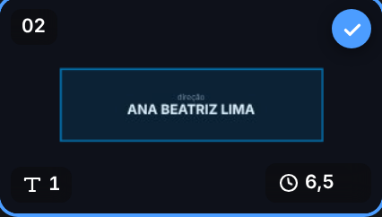
</p>

**4.3** for larger selections, use **select by range** :

<table>
  <tr>
    <td width="400">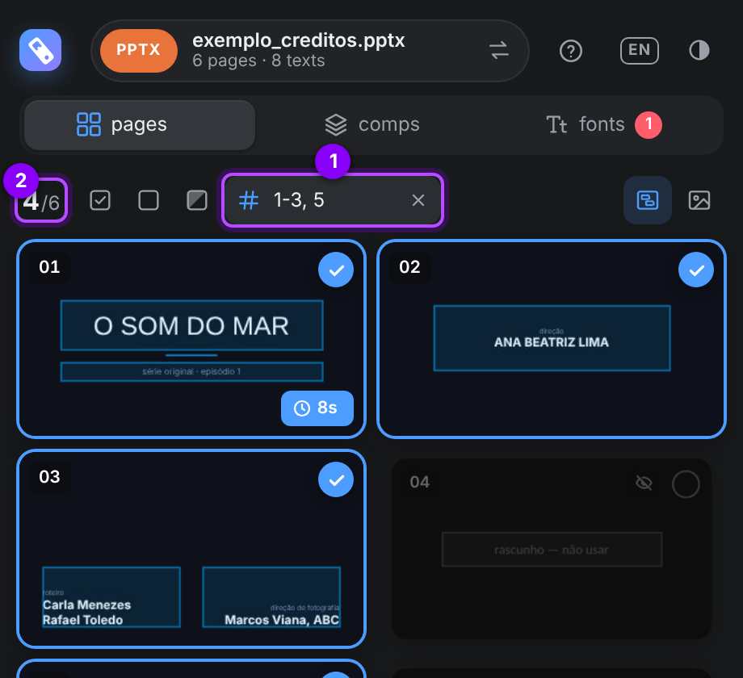</td>
    <td>

1. click the `#` and type the pages, then `Enter` (or just click outside the field):
   - `1-3, 5` → pages 1, 2, 3 and 5
   - `8-` → from 8 to the end
   - `-4` → from 1 to 4
2. **only** those pages stay selected.
3. the **×** at the end of the field clears the text.

  </td>
  </tr>
</table>

<br>

---

<br>

## 5 · set up the comps

**5.1** in the **comps** tab:

<table>
  <tr>
    <td width="400">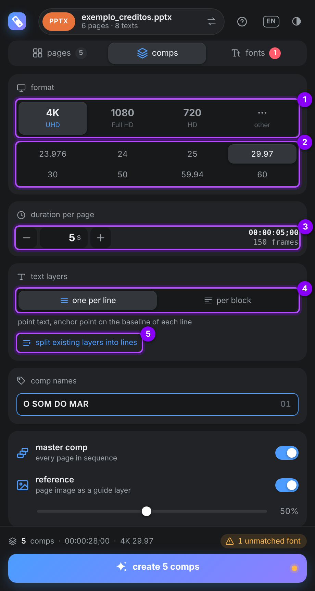</td>
    <td>

1. **format** → `4K` (3840 × 2160), `1080` (1920 × 1080), `720` (1280 × 720) or `···` for a custom size.
2. **frame rate** → default **29.97**.
3. **duration per page** → `−` / `+` in 0.5 s steps (or type it; `↑` `↓` also work). next to it, the timecode and the frames.
4. **text layers**:
   - **one per line** (default) → each line becomes a **point text** layer, with the **anchor point at [0, 0] on the baseline**, at the alignment point (start, center or end of the line). nothing gets cut if the new font is wider.
   - **per block** → one layer per PowerPoint text box (*paragraph text*) or per PDF paragraph.
5. **split existing layers into lines** → the same result as the *one per line* mode, applied afterwards (see [step 7.5](#7--create-the-comps)).

the footer sums it all up: number of comps, total duration, format and frame rate.

  </td>
  </tr>
</table>

**5.2** further down and in **fine-tuning**:

<table>
  <tr>
    <td width="400">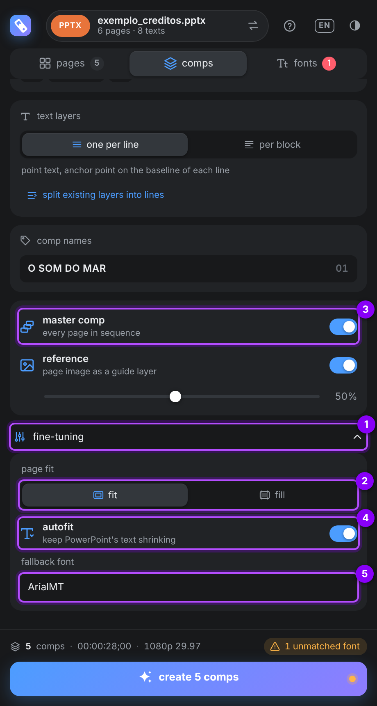</td>
    <td>

1. opens / closes fine-tuning.
2. **page fit** → *fit* (whole page visible) or *fill* (crops the edges) when the document's aspect ratio differs from the comp's.
3. **master comp** → every page in sequence, with one marker per page.<br>**reference** → page image as a locked **guide layer**; when turned on, the opacity shows up.
4. **autofit** (PPTX) → keeps the text shrinking PowerPoint applies when the text doesn't fit in the box.
5. **fallback font** → PostScript name used when a font is not matched (default `ArialMT`).

  </td>
  </tr>
</table>

> 🚩 *note:*\
> • the settings are saved for next time.\
> • guide layers don't show up in the final render, nor when the comp is used as a precomp.

<br>

---

<br>

## 6 · match the fonts

**6.1** the **fonts** tab lists each document font as **source → destination**, with a preview of the text in the destination font. the red number on the tab shows how many still have **no font**.

<table>
  <tr>
    <td width="400"></td>
    <td>

1. **1 unmatched font** (the document uses *Gotham Black*, which isn't installed; the *Calibri* fonts came already matched to **Carlito**).
2. 🔴 **no font** → if it stays like this, the layer uses the **fallback font**. the missing ones stay at the top of the list.
3. 🟢 **automatic** → PowerPoint's *Inter Bold* was found and matched on its own. 🔵 = chosen by you.
4. **preview** with the document's own text, in the destination font.
5.  **match automatically** again.
6.  **read from project** (see [step 8](#8--swap-the-fonts-later)).

  </td>
  </tr>
</table>

**6.2** click a font to **open** it and swap it:

<table>
  <tr>
    <td width="400"></td>
    <td>

example: *Gotham Black* isn't installed → swapped for **Inter Black**:

1. click the row to open it (click again, or on another font, to close it).
2. **family** → click and type to search (`Inter`). see the [font picker](#-font-picker) below.
3. **style** → `Black` (when you change the family, the style closest to the original is already picked).
4. **size scale** → `−` / `+` in 5 % steps. here `95 %`: the new font is a little wider.
5. the text in the **original** font (if it's installed), for comparison.

the *Calibri* fonts aren't installed, but the panel matched them by itself to **Carlito**, which has the **same metrics** (the text takes up the same space). this applies to the known pairs — *Calibri → Carlito*, *Cambria → Caladea*, *Arial / Helvetica → Liberation Sans*, *Times New Roman → Liberation Serif*, *Courier New → Liberation Mono* — when the equivalent is installed. the dot's tooltip says it's an equivalent; to use another font, just change it.

  </td>
  </tr>
</table>

#### 🔎 font picker

<table>
  <tr>
    <td width="400">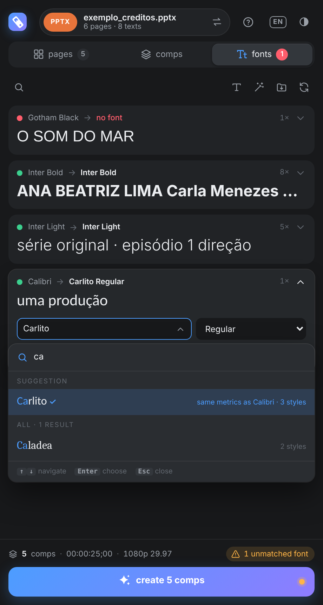</td>
    <td>

- type part of the name to filter; each font is **drawn in itself**;
- **suggestion** → installed font with the **same metrics** as the original (*Calibri → Carlito*, *Cambria → Caladea*, *Arial → Liberation Sans*…);
- **recent** → the last families chosen stay at the top;
- `↑` `↓` navigate, `Enter` picks, `Esc` closes.

  </td>
  </tr>
</table>

after swapping a font, if the document has **other styles of the same family** (e.g. *Calibri* and *Calibri Bold*), the panel offers to swap them all at once, keeping the weight of each one:

<p align="center">
  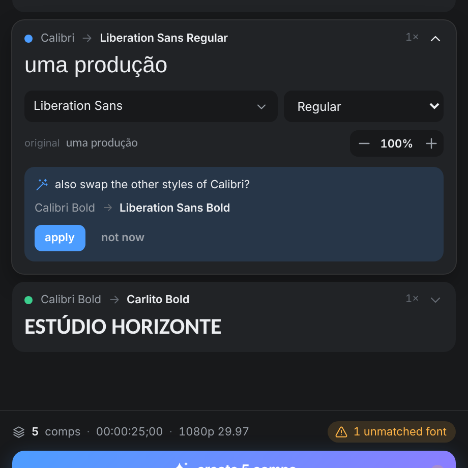
</p>

**6.3** to compare with another text (accents, numbers…), click  (1), type the **preview text** (2) and adjust the **preview size** (3):

<p align="center">
  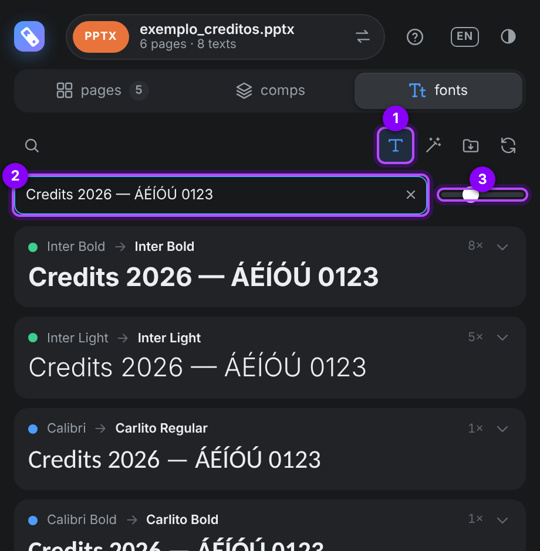
</p>

**6.4** the list follows the **selected pages**. a font that only appears in unchecked pages moves down to the collapsed group **not used in the selected pages**, at the end of the list. it doesn't count toward the tab's red warning, and its match is kept. check the page again and the font goes back to its place. click the group to see the fonts in it.

> 💡 *tips:*\
> • manual choices are **remembered**: in the next document with the same font, the match is already in place.\
> •  reloads the list of installed fonts (handy after activating a font in Adobe Fonts).\
> •  filters by the document font name.

<br>

---

<br>

## 7 · create the comps

**7.1** before creating, the panel warns you about what might go wrong. if any font used in the selected pages is unmatched, the footer shows **⚠ N unmatched fonts** and the button gets an orange dot. click the warning to go straight to the missing font:

<p align="center">
  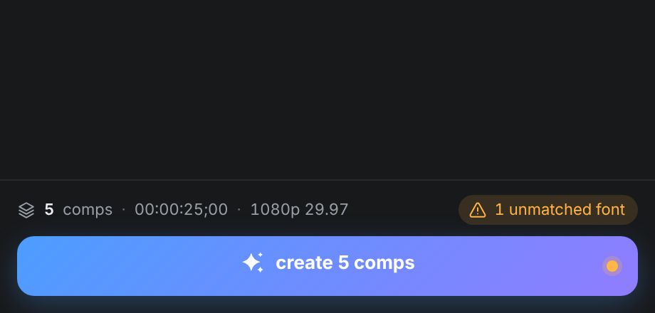
</p>

when you click **create**, if there's something to decide, the **before creating** sheet slides up:

<table>
  <tr>
    <td width="400">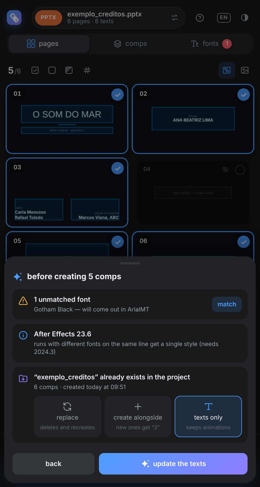</td>
    <td>

- ⚠ **unmatched fonts** → which ones they are and which font they'll come out in. **match** takes you to the fonts tab, with the first one already open.
- ⓘ **After Effects version** → only shows up if AE is older than 2024 (24.3) and the document has runs with different fonts on the same line.
- 📁 **the document already exists in the project** → choose:
  - **texts only** (default) → keeps the comps, positions, animations and effects and only swaps the **content** of the text layers. new texts become new layers; layers that lost their text stay and show up in the warnings;
  - **create alongside** → keeps the old ones; the new ones go to the folder “name 2” and the comps get “(2)”;
  - **replace** → deletes the document's old folder and comps and creates them again.

`Enter` confirms, `Esc` goes back. with nothing to decide, the button creates right away.

  </td>
  </tr>
</table>

**7.2** click **create N comps** (or **update the texts**). the button itself turns into the progress bar:

<p align="center">
  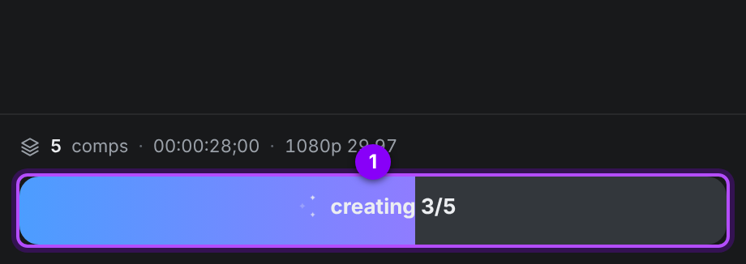
</p>

**7.3** at the end, the button turns green with a ✔, and a message confirms how many comps were created (1). if there are **warnings**, the ⚠ shows up with the count (2):

<p align="center">
  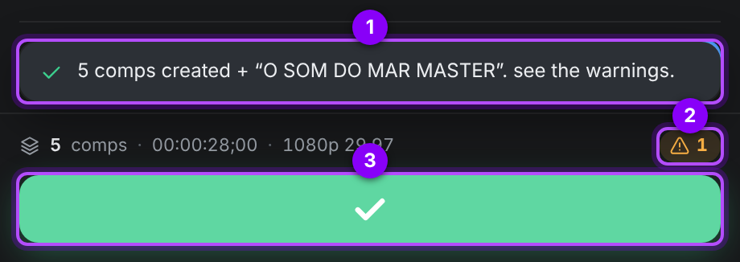
</p>

the final notice has shortcuts to **open master** and **show in project** (selects the document folder in the *Project* panel):

<p align="center">
  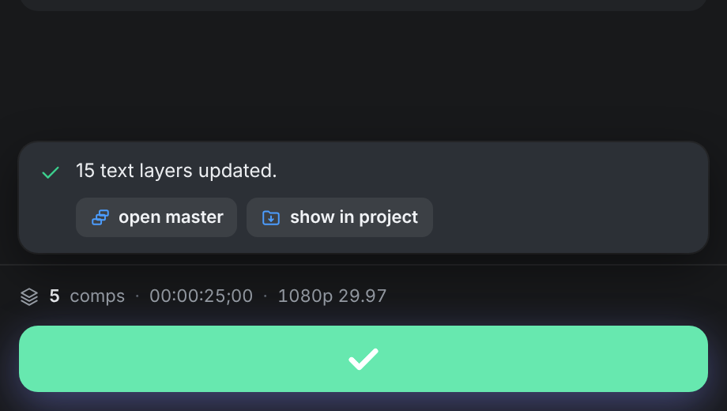
</p>

click the ⚠ to see the list:

<p align="center">
  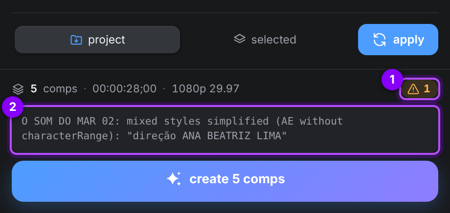
</p>

common warnings:
- `font "X" unavailable (…) → ArialMT` → the chosen font isn't installed on this machine and the layer used the fallback;
- `mixed styles simplified` → the layer has different fonts/sizes, but the After Effects version is older than 2024 (24.3), so it got a single style.

**7.4** in the project, ABRIDOR creates:

```
📁 ABRIDOR
 └─ 📁 exemplo_creditos            ← one folder per document
     ├─ 🎞 O SOM DO MAR MASTER      ← every page in sequence, with markers
     ├─ 📁 referências              ← page images (PNG)
     └─ 📁 slides
         ├─ 🎞 O SOM DO MAR 01      ← one comp per selected page
         ├─ 🎞 O SOM DO MAR 02
         └─ …
```

(the folder names `slides` and `referências` — Portuguese for "references" — are always created with these names.)

in each page comp: the **text layers**, named after the text itself, and underneath them the **REF**, the locked guide layer with the page image (see the [illustration at the top](#-abridor)).

**7.5** to split into lines layers that already exist (created *per block*, by an earlier version of ABRIDOR or even typed by hand):

1. select the **text layers** in the active comp — or select **comps** in the *Project* panel to split all of their text layers;
2. in the **comps** tab, click **split existing layers into lines**.

each line becomes a point text layer with the anchor point zeroed on the baseline, in the same place, with the same colors, fonts, scale, rotation, parent and timing. layers with keyframes or an expression on the text are skipped (they show up in the warnings). `Edit` > `Undo` undoes it all at once.

> 🚩 *note:*\
> • the reference images are saved in a `<document name>_ABRIDOR` folder next to the document (or in the temporary folder, if it can't write there or if the file was dragged in without a known path).\
> • each step can be undone with `Edit` > `Undo`.\
> • the **Comment** column of the text layers stores the original font (`ABRIDOR {...}`). **don't delete** that comment if you want to swap the fonts later.

<br>

---

<br>

## 8 · swap the fonts later

the layers created by ABRIDOR remember the original font of each run. that's why the fonts can be swapped **at any time** — the same day or months later, with or without the original document.

**8.1** open the project and go to the **fonts** tab. with no document open, use **read from project** (1):

<p align="center">
  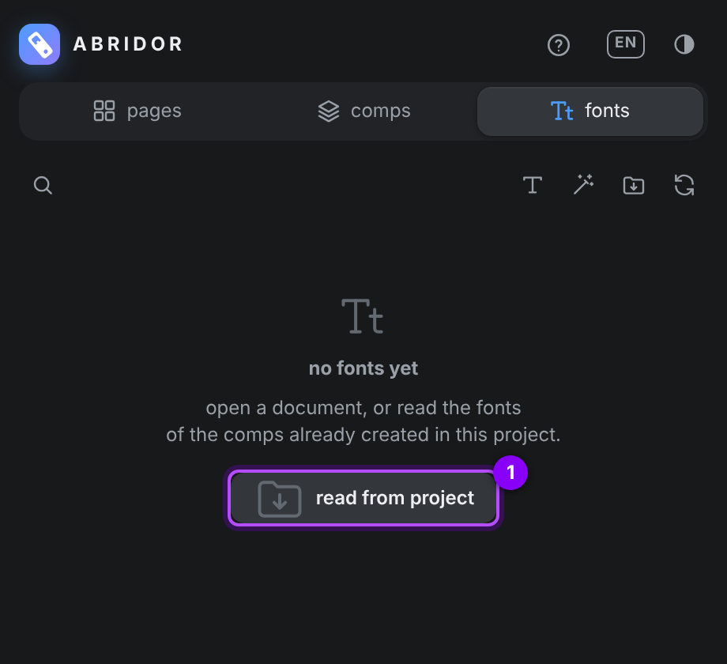
</p>

**8.2** the fonts of the layers already created show up, with the last mapping used. swap whatever you want and apply:

<table>
  <tr>
    <td width="400">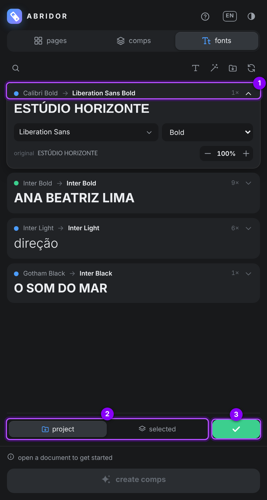</td>
    <td>

1. swap the font (here *Calibri Bold* → **Liberation Sans Bold**).
2. choose where to apply:
   - **project** → in every comp in the project;
   - **selected** → only in the comps selected in the *Project* panel.
3. **apply** → the button confirms with ✔ when it's done.

the **apply** bar only shows up when there are ABRIDOR comps in the project (after creating or reading from the project).

  </td>
  </tr>
</table>

> 🚩 *note:*\
> • the swap keeps sizes adjusted by hand (except in layers with mixed fonts, which go back to the original size × scale).\
> • it also works with *Source Text* keyframes.

<br>

---

<br>

## 💡 tips and common issues

**the panel doesn't show up in `Window` > `Extensions`.**\
restart After Effects after installing. on macOS, restart the computer too. check that the `com.abridor.panel` folder exists in:
- Windows: `%APPDATA%\Adobe\CEP\extensions\`
- macOS: `~/Library/Application Support/Adobe/CEP/extensions/`

**a PDF page shows 0 texts (or texts are missing).**\
the text is an **image** or was converted to **outlines** in the PDF. there's no way to extract it: type that text in After Effects or ask for the original PPTX.

**I want a reference identical to PowerPoint.**\
the PPTX reference is an approximate render (background, images, shapes and texts). to make it identical:
1. in PowerPoint, `File` > `Export` > `Change File Type` > `PNG` (all slides);
2. in ABRIDOR, **pages** tab > **external images…** and choose the folder with the PNGs. the images are matched by the numeric order of the files (`Slide1.png`, `Slide2.png`, …) and the pages get the **IMG** tag. the **×** goes back to the internal reference.

or save the PPTX as PDF and use the PDF.

**the text came out wider / wrapped into more lines than in the document.**\
the replacement font is wider than the original. adjust the font's **size scale** in the **fonts** tab and apply again. text boxes are created with extra room in height so lines don't get cut.

**PDF: I wanted one layer per line.**\
**comps** tab > **text layers** > *one per line*. the document is re-read right away.

**PPTX: the text is smaller than in PowerPoint.**\
PowerPoint shrinks the text when it doesn't fit in the box (*autofit*), and ABRIDOR copies that shrinking. to use the original size, turn off **autofit** (*keep PowerPoint's text shrinking*) under **fine-tuning** in the **comps** tab.

### 📋 After Effects versions

| feature | minimum version |
| --- | --- |
| panel, creating the comps, swapping fonts | **2020 (17.0)** |
| installed font list, automatic matching and preview | **2024 (24.0)** — before that, type the PostScript name |
| different fonts / sizes / colors **in the same layer** | **2024 (24.3)** — before that, the layer uses the predominant style |

<br>

---

<br>

## 🔍 how the texts are recreated

| | **PPTX** | **PDF** |
| --- | --- | --- |
| layer type | *one per line*: point text per line, anchor on the baseline · *per block*: text box the size of the PowerPoint box | *one per line*: point text per line · *per block*: point text per paragraph; anchor always on the exact **baseline** |
| alignment | horizontal (left / center / right / justified) and vertical (top / middle / bottom) | detected from the geometry of the lines |
| font / size / color | inherited from slide → layout → master → theme | embedded PostScript name, exact size and color from the PDF |
| leading | PowerPoint model: 1.2 × size × spacing, 1st baseline at (leading − 0.2 × size) from the top, space before/after paragraph, vertical alignment of the box (incl. autofit) | measured distance between lines |
| other | rotation, groups, tables, placeholders, all caps, letter spacing | rotation, runs with different colors / fonts |

<br>

---

<br>

## 🌐 languages and translations

the panel, the After Effects messages and the installer are in **português**, **English** and **español**.

- **in the panel:** the **PT / EN / ES** button at the top changes the language instantly, without losing the open document. the choice is remembered. the first time, the panel uses the After Effects language (if it's none of the three, it uses English).
- **in the installer:** follows the After Effects language.

all texts live in a single file: **`abridor-cep/i18n/strings.csv`** — one row per text, one column per language. you can open it in Excel, Google Sheets or a text editor:

```
key,pt,en,es
app.cta.createAll,criar comps,create comps,crear comps
app.pages.one,{n} página,{n} page,{n} página
app.pages.other,{n} páginas,{n} pages,{n} páginas
```

- **fix a translation:** edit the cell in the ABRIDOR folder and run the installer again (or edit the installed extension's `strings.csv` directly) and reopen the panel.
- **new language:** add a column with the 2-letter code (e.g. `fr`) and fill it in. it shows up right away in the language button and in the installer. an empty cell uses Portuguese.
- `{name}` is replaced by a value (number of pages, font name…) — keep it the same in every column.
- keys ending in `.one` / `.other` are singular and plural.
- `\n` is a line break; rows starting with `#` are comments.
- the separator can be a comma or a semicolon (Excel in Portuguese usually saves with `;`). always save as **UTF-8**.

> ⚠️ *note:* the prefixes tell where the text appears: `panel.*` and `app.*` in the panel, `tour.*` in the guided tour, `err.*` / `parser.*` in errors and page names, `host.*` in the warnings and in the After Effects undo history, `inst.*` in the installer.

<br>

---

<br>

## 🛠 development

```
abridor-cep/
├── CSXS/manifest.xml     → CEP manifest (AEFT 17+)
├── index.html            → interface
├── css/style.css
├── js/
│   ├── i18n.js           → translations (reads i18n/strings.csv)
│   ├── cep.js            → bridge to AE (evalScript) and file system (Node)
│   ├── ui.js             → icons, expand/collapse animations, segmented controls, toasts
│   ├── pptx-parser.js    → PPTX reading (zip + XML)
│   ├── pdf-parser.js     → PDF reading (pdf.js)
│   ├── render.js         → thumbnails / PPTX reference
│   ├── fonts.js          → installed fonts, automatic matching, preview
│   ├── app.js            → panel logic
│   └── lib/              → JSZip 3.10.1, pdf.js 3.11.174 (legacy)
└── jsx/host.jsx          → comp creation and font swapping (ExtendScript)
```

- debugging: with the panel open in AE, go to `http://localhost:8099` in Chrome (`.debug` file).
- tests outside After Effects (Node + Playwright):
  - every panel test accepts `ABR_LANG=en` or `ABR_LANG=es` (default `pt-BR`), e.g.: `ABR_LANG=en node tests/run_panel.js …`. `tests/pw.js` sets up Playwright (language and access to the CSV).
  - `node tests/run_panel.js <file.pptx|pdf> <output>` → opens the panel in Chromium with a simulated AE, extracts and generates the job.
  - `node tests/host_mock.js <output>/job.json <output>/host` → runs `host.jsx` against an After Effects mock and draws the layers over the reference.
  - `node tests/tour_check.js <output>` → checks the guided tour: first time, steps, keyboard, **?** button and tour without a document (with `--docs`, saves the README screenshots).
  - `node tests/features_check.js <output>` → checks in the panel the before-creating check, the font picker, the family swap, shift+click, the end actions and the recent files (with `--docs`, saves the README screenshots).
  - `MODES=new,texts,side,replace node tests/host_mock.js …` → runs the creation modes in sequence in the After Effects mock.
  - `node tests/installer_mock.js <temp folder>` → runs the installer with simulated File/Folder/ScriptUI (installs and removes).
  - `node tests/ux_walk.js <output>` → real-use walkthrough (first run with the tour, a real PDF, narrow panel; `W=` and `H=` change the size); `node tests/ux_sizes.js <output>` → panel at extreme sizes; `node tests/ux_edge.js <output>` → errors and invalid input (corrupted file, After Effects failure, field limits, reopening the panel).
  - `python3 tests/make_test_pptx.py <file.pptx>` → generates a PPTX with assorted cases.
- README screenshots:
  - `python3 tests/make_example_pptx.py` → generates `exemplo_creditos.pptx`.
  - `node tests/make_screenshots.js` → generates all screenshots in `docs/img` (real panel in Chromium with a simulated AE; installer, menu and project are illustrations in `tests/illustrations.html`).
  - `node tests/make_demo.js` → records the `docs/img/demo.gif` animation (needs `ffmpeg`).
  - screenshots in other languages: run `make_screenshots.js`, `make_demo.js`, `features_check.js <output> --docs` and `tour_check.js <output> --docs` with `ABR_LANG=en` or `ABR_LANG=es` → they go to `docs/img/en/` and `docs/img/es/` (same file names).
  - `python3 tests/make_micro_css.py` → generates `css/micro.css`, the hover micro-interactions of each icon.
  - `node tests/micro_preview.js <output>` → records the micro-interactions catalog and the panel in use (GIFs, needs `ffmpeg`).
  - `node tests/make_banner.js` → generates the installer banner (with the logo) and writes the ExtendScript string into the installer.
- `js/lib/pdf.js` and `pdf.worker.js` have one change: `isNodeJS = false`, because CEP exposes `process` and pdf.js would try to use Node APIs.
