# 🧾 ABRIDOR

🗨️ [português](README.md) · [English](README.en.md) · **español**

⚡ Extensión de After Effects para agilizar la creación de los layouts de una apertura ⚡

**ABRIDOR** lee archivos **PPTX** y **PDF** directamente —sin conversiones ni sitios externos— y recrea cada página/diapositiva como una comp de After Effects, con los textos lo más fieles posible al original: posición, alineación, tamaño, interlineado, color, rotación y fuentes. Las fuentes del documento se pueden cambiar por otras, con vista previa, **antes o después** de crear las comps.

<p align="center">
  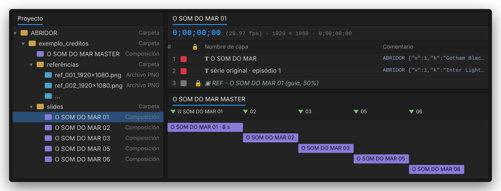
  <br><sub><i>ilustración: lo que ABRIDOR crea en el proyecto — una comp por página, la comp master en secuencia y las referencias.</i></sub>
</p>

<br>

## 📑 índice

1. [instalar](#1--instalar)
2. [abrir el panel](#2--abrir-el-panel)
3. [abrir el documento](#3--abrir-el-documento)
4. [elegir las páginas](#4--elegir-las-páginas)
5. [configurar las comps](#5--configurar-las-comps)
6. [asociar las fuentes](#6--asociar-las-fuentes)
7. [crear las comps](#7--crear-las-comps)
8. [cambiar las fuentes después](#8--cambiar-las-fuentes-después)
9. [consejos y problemas comunes](#-consejos-y-problemas-comunes)
10. [cómo se recrean los textos](#-cómo-se-recrean-los-textos)
11. [idiomas y traducciones](#-idiomas-y-traducciones)

> 📂 **archivos** (los nombres están en portugués; *instalar o ABRIDOR* = «instalar el ABRIDOR»):\
> • **INSTALAR O ABRIDOR.jsx** → instalador (se ejecuta dentro de After Effects).\
> • **abridor-cep/** → la extensión (panel CEP).\
> • **instalar_windows.bat** / **instalar_mac.command** → instaladores alternativos, sin abrir After Effects.\
> • **test files/exemplo_creditos.pptx** → PPTX de ejemplo para probar (es el que se usa en las capturas de abajo).

<br>

---

<br>

## 1 · instalar

> ✅ **requisitos:** After Effects **2020 (17.0)** o más reciente. se recomienda **2024 (24.3)** o más reciente — consulta la [tabla de versiones](#-versiones-de-after-effects).

**1.1** en After Effects, abre `Archivo` > `Secuencias de comandos` > `Ejecutar archivo de script...` (`File` > `Scripts` > `Run Script File...`) y elige **INSTALAR O ABRIDOR.jsx** directamente desde la carpeta de ABRIDOR (la carpeta que tiene `abridor-cep` dentro).

**1.2** el instalador revisa solo lo que hace falta. **si todo está bien**, abre directamente con la bienvenida, el aviso *¡todo listo!* y el botón **instalar** (o **actualizar** / **reinstalar**, si ya hay una versión en la computadora; **eliminar** la desinstala). la pantalla muestra desde dónde se va a copiar la extensión y hacia dónde.

<table>
  <tr>
    <td align="center">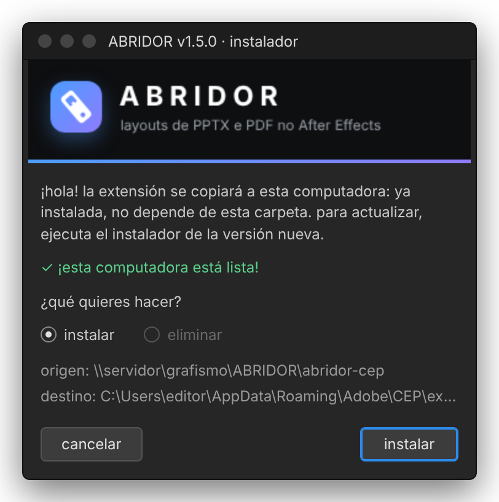<br><sub>1.2 · todo listo: solo hay que instalar</sub></td>
  </tr>
</table>

**1.3** si algo necesita atención, el instalador abre con la bienvenida —haz clic en **empezar**— y muestra la revisión: punto 🟢 = ok, 🟡 = funciona con limitaciones, 🔴 = hay que resolverlo. si la escritura de archivos está bloqueada, usa el enlace **› abrir preferencias de scripts y expresiones**, marca *Permitir que los scripts escriban archivos y accedan a la red* (*Allow Scripts to Write Files and Access Network*) en `Preferencias` > `Scripts y expresiones` (`Preferences` > `Scripting & Expressions`) y haz clic en **› verificar de nuevo**. después, **siguiente** lleva a la misma elección de instalar / actualizar.

<table>
  <tr>
    <td align="center">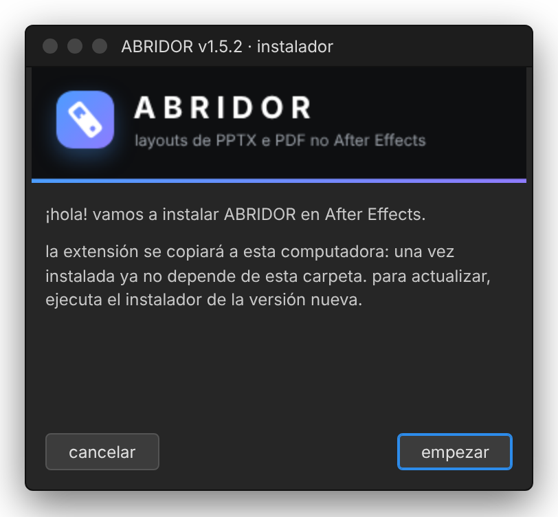<br><sub>1.3 · bienvenida</sub></td>
    <td align="center">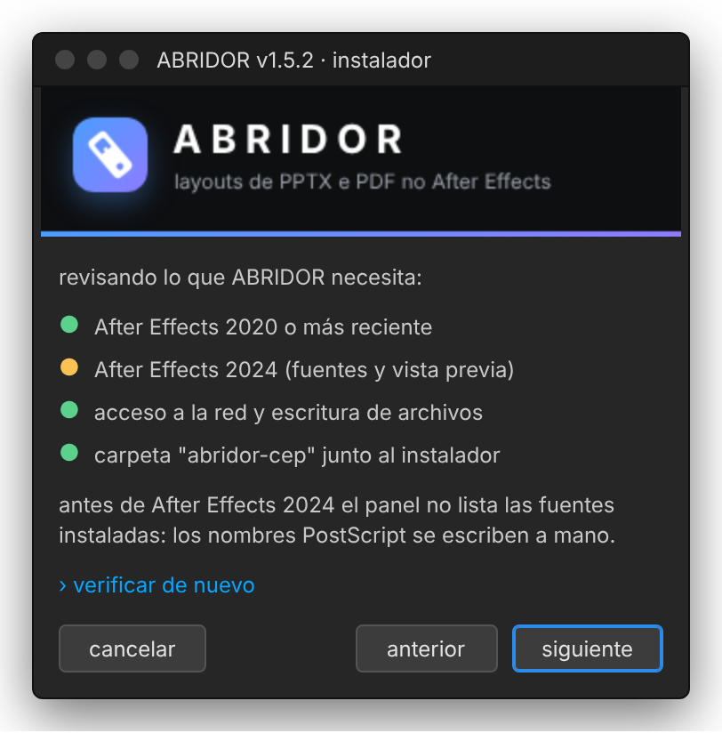<br><sub>1.3 · revisión</sub></td>
  </tr>
</table>

**1.4** ¡listo! **reinicia After Effects**.

<table>
  <tr>
    <td align="center">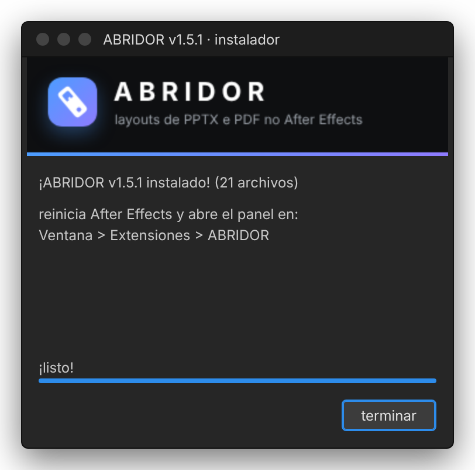<br><sub>1.4 · terminado</sub></td>
  </tr>
</table>

<sub><i>ilustraciones de la ventana del instalador.</i></sub>

> 🚩 *nota:*\
> • la instalación es **siempre local**: toda la carpeta `abridor-cep` se copia a la carpeta de extensiones del usuario. después de eso ABRIDOR ya no depende de la carpeta de origen (red, memoria USB o descarga). para actualizar, ejecuta el instalador de la versión nueva.\
> • la extensión no está firmada, por eso el instalador habilita el `PlayerDebugMode` de CEP.\
> • **macOS:** si el panel no aparece después de reiniciar After Effects, reinicia la computadora.

<br>

---

<br>

## 2 · abrir el panel

**2.1** en After Effects, abre `Ventana` > `Extensiones` > `ABRIDOR` (`Window` > `Extensions` > `ABRIDOR`). el panel se puede acoplar en cualquier lugar del espacio de trabajo, como los demás paneles. se ajusta al espacio: angosto, muestra lo esencial en una columna; ancho, la pestaña **comps** pasa a dos columnas.

<p align="center">
  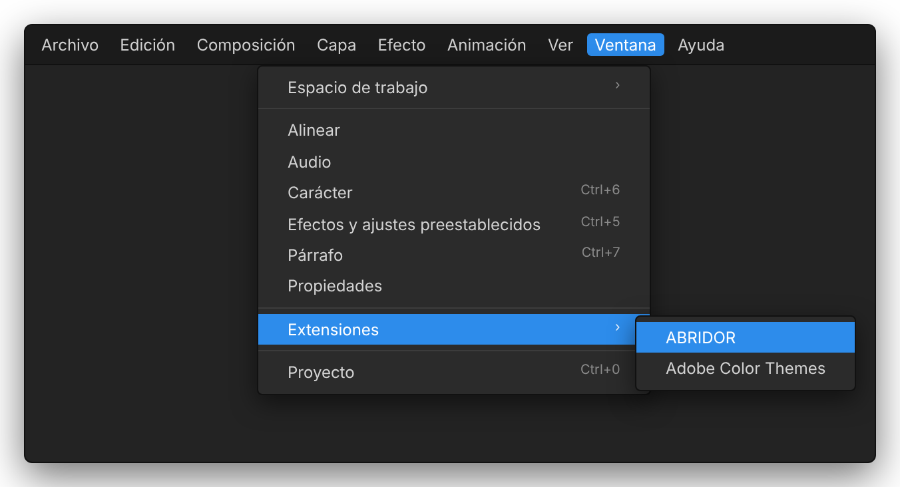<br>
  <sub><i>ilustración del menú de After Effects.</i></sub>
</p>

**2.2** el panel abre listo para recibir un documento:

<table>
  <tr>
    <td width="400">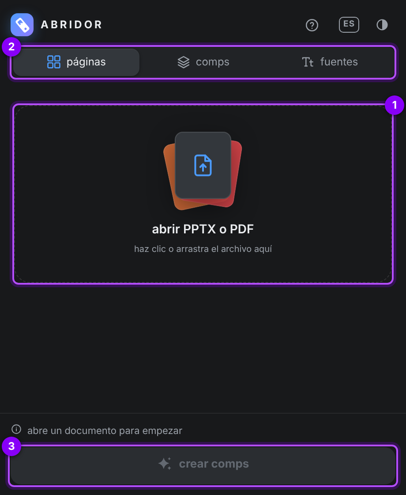</td>
    <td>

1. **haz clic** en el área o **arrastra** un `.pptx` / `.pdf` al panel (atajo: `Ctrl/Cmd + O`).
2. **pestañas** → `páginas`, `comps` y `fuentes`.
3. **crear comps** → se activa después de abrir un documento.

  </td>
  </tr>
</table>

<p align="center">
  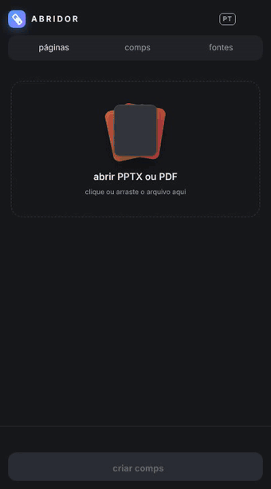<br>
  <sub>el panel en acción: selección de páginas, duración, formato, fuentes y creación.</sub>
</p>

**2.3** la primera vez que abres un documento, el panel ofrece un **recorrido guiado** (tour) de 5 pasos, usando el propio documento: páginas, duración, formato, fuentes y el botón de crear. `→` / `Enter` avanzan, `←` retrocede, `Esc` lo salta. para volver a verlo, haz clic en el **?** de arriba.

<table>
  <tr>
    <td align="center"><br><sub>bienvenida</sub></td>
    <td align="center">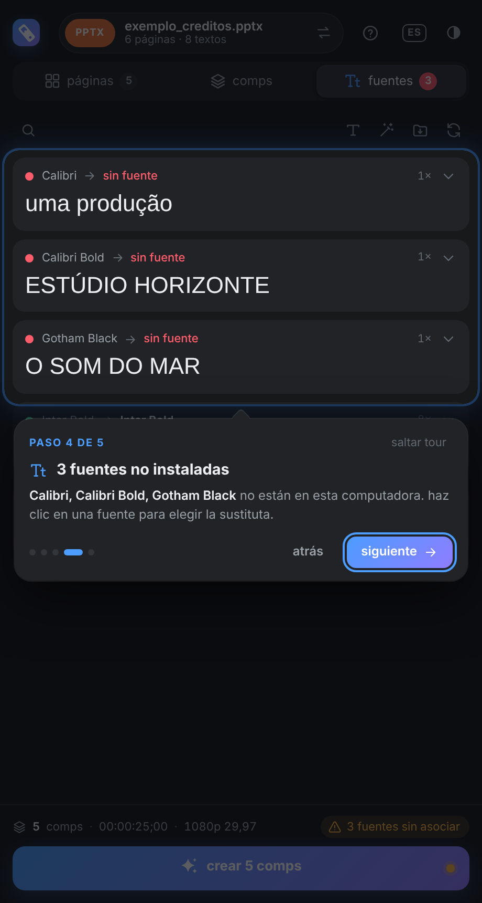<br><sub>paso 4: las fuentes que faltan en este documento</sub></td>
  </tr>
</table>

**2.4** pasa el mouse sobre cualquier botón para ver el **tooltip**: qué hace y, cuando lo hay, el atajo de teclado. en las miniaturas, el tooltip lista los textos encontrados en la página.

<p align="center">
  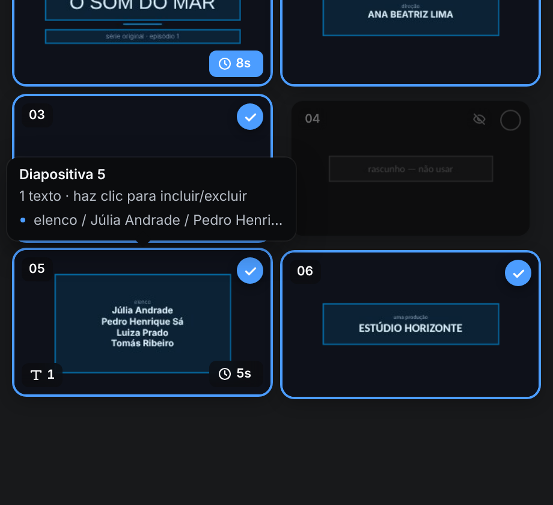
</p>

atajos: `Ctrl/⌘ + O` abre un documento · `1` `2` `3` cambian de pestaña · `Ctrl/⌘ + Enter` crea las comps · `↑` `↓` cambian la duración.

**2.5** el panel tiene **tema claro y oscuro**. el botón de la esquina superior derecha alterna entre:

<p align="center">
  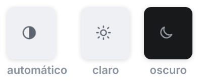
</p>

- **automático** (predeterminado) → sigue el brillo de la interfaz de After Effects (`Preferencias` > `Apariencia` (`Preferences` > `Appearance`)) y cambia junto con él si ajustas AE;
- **claro** u **oscuro** → fijo, independiente de After Effects.

<table>
  <tr>
    <td align="center">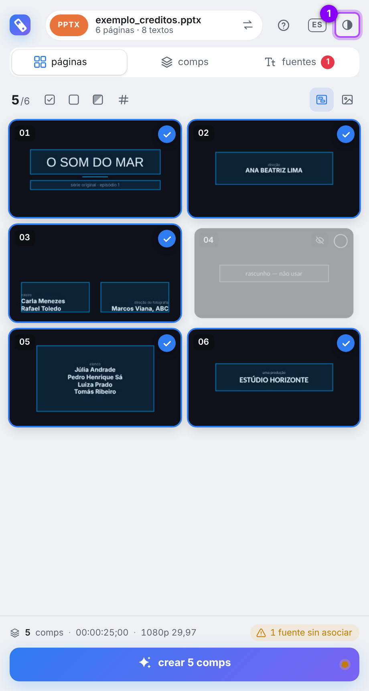<br><sub>tema claro: páginas</sub></td>
    <td align="center"><br><sub>tema claro: fuentes</sub></td>
  </tr>
</table>

**2.6** el botón **PT / EN / ES** junto al tema cambia el idioma del panel: **português → English → español**. el cambio es inmediato, sin cerrar el documento abierto, y queda guardado. la primera vez, el panel sigue el idioma de After Effects. consulta [idiomas y traducciones](#-idiomas-y-traducciones) para corregir textos o agregar otro idioma.

<br>

---

<br>

## 3 · abrir el documento

**3.0** la pantalla vacía lista los **documentos recientes** (**recientes**): haz clic para volver a abrirlos. los archivos que cambiaron de lugar aparecen atenuados (la **×** los quita de la lista; **limpiar** vacía la lista sin borrar archivos).

<p align="center">
  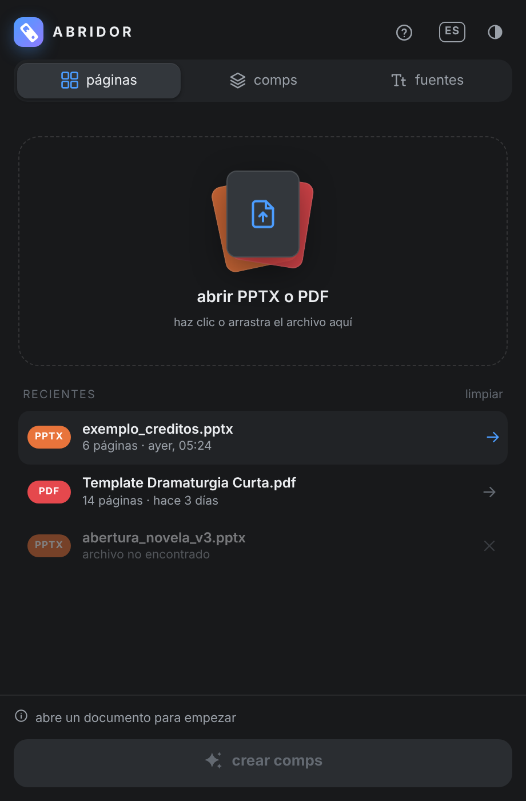
</p>

**3.1** cada página aparece en miniatura, con los textos detectados resaltados encima.

<table>
  <tr>
    <td align="center">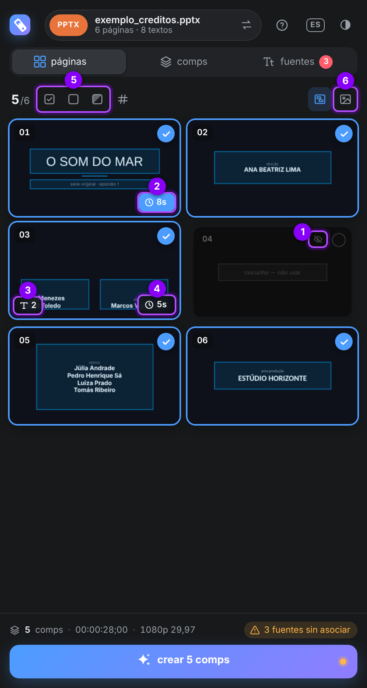<br><sub>PPTX: <code>exemplo_creditos.pptx</code></sub></td>
    <td align="center">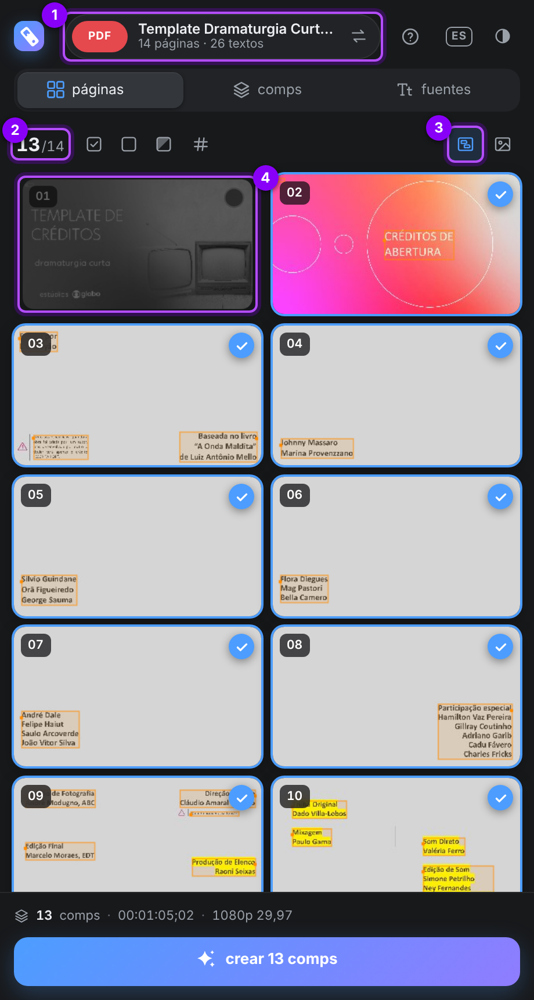<br><sub>PDF: plantilla de créditos</sub></td>
  </tr>
</table>

en el **PPTX** (a la izquierda):

1.  las diapositivas **ocultas** en PowerPoint ya vienen **desmarcadas**.
2.  **duración de esta página** → en azul cuando se modificó (aquí, 8 s).
3.  **textos detectados** en la página (aparece al pasar el mouse).
4. la duración predeterminada también aparece al pasar el mouse — haz clic para cambiarla.
5. selección rápida: **seleccionar todas**, **limpiar selección** e **invertir selección**.
6.  **imágenes externas** → usa PNG/JPG exportados de PowerPoint como referencia (ver [consejos](#-consejos-y-problemas-comunes)).

en el **PDF** (a la derecha):

1. el documento abierto. haz clic en él para **cambiar de documento**.
2. páginas seleccionadas / total.
3.  activa/desactiva el resaltado de los textos: 🟦 **azul** = cuadro de texto, 🟧 **naranja** = texto de punto.
4. la página 1 se **desmarcó** con un clic: su título es una **imagen** dentro del PDF (solo el "globo" es texto).

**3.2** cada resaltado se convierte en **una capa de texto**. abajo, la misma detección en tamaño grande, con la fuente, el tamaño y la alineación que ABRIDOR leyó de cada bloque:

<p align="center">
  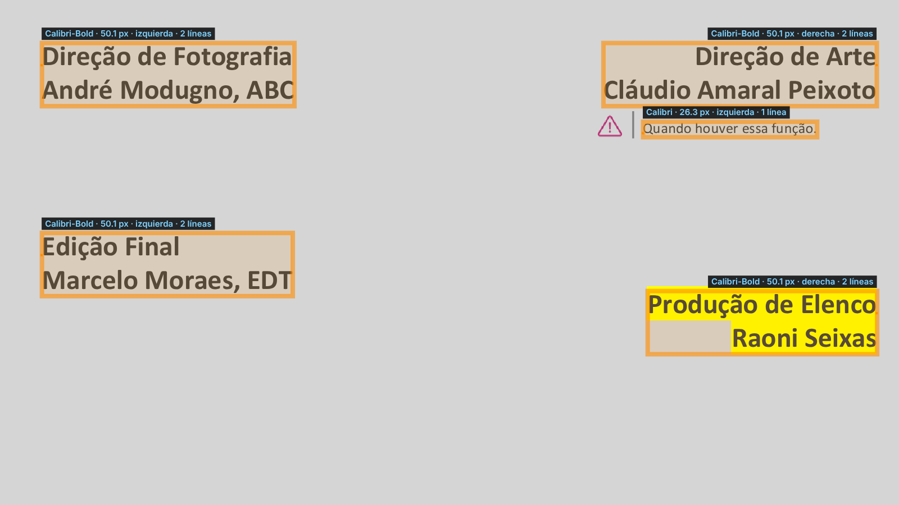<br>
  <sub>PDF: bloques a la izquierda y a la derecha detectados por la geometría de las líneas, con la fuente y el tamaño exactos de cada uno.</sub>
</p>

<table>
  <tr>
    <td align="center">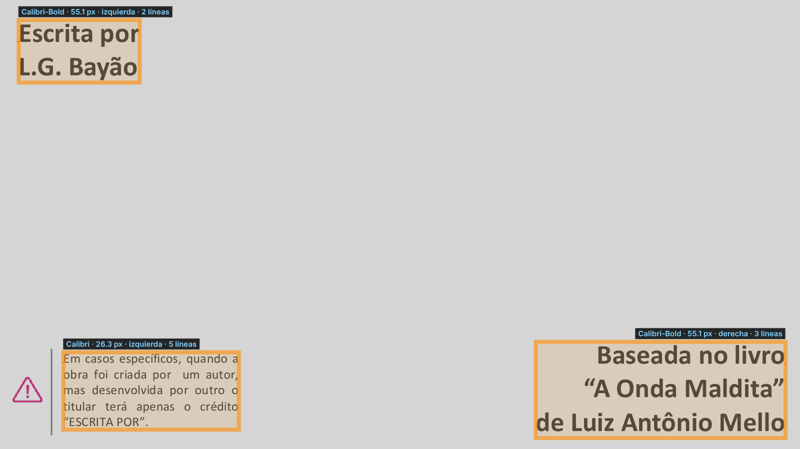<br><sub>PDF: párrafos de varias líneas agrupados en una capa.</sub></td>
    <td align="center"><br><sub>PPTX: cuadros de PowerPoint (alineados abajo, a la izquierda y a la derecha).</sub></td>
  </tr>
</table>

<br>

---

<br>

## 4 · elegir las páginas

**4.1** haz clic en la **miniatura** para incluir o excluir la página: la seleccionada recibe borde azul y ✔; la excluida queda atenuada y no se convierte en comp.

mantén **shift** y haz clic en otra miniatura para marcar o desmarcar **todo el intervalo** entre las dos. con shift presionado, el panel ya muestra el intervalo antes del clic:

<p align="center">
  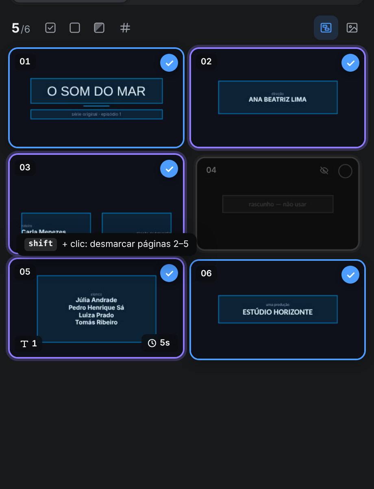
</p>

**4.2** para cambiar la **duración de una página**, haz clic en el reloj, escribe los segundos (acepta coma: `6,5`) y presiona `Enter`. déjalo vacío para volver a la duración predeterminada; `Esc` cancela.

<p align="center">
  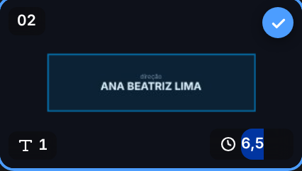
</p>

**4.3** para selecciones más grandes, usa el **intervalo** :

<table>
  <tr>
    <td width="400">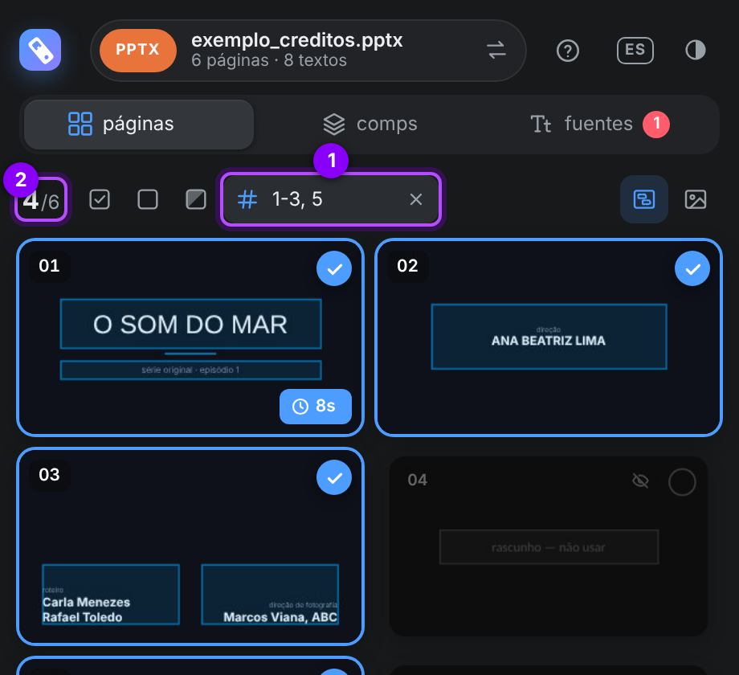</td>
    <td>

1. haz clic en el `#` y escribe las páginas, luego `Enter` (o simplemente haz clic fuera del campo):
   - `1-3, 5` → páginas 1, 2, 3 y 5
   - `8-` → de la 8 hasta el final
   - `-4` → de la 1 a la 4
2. quedan seleccionadas **solo** esas páginas.
3. la **×** al final del campo borra el texto.

  </td>
  </tr>
</table>

<br>

---

<br>

## 5 · configurar las comps

**5.1** en la pestaña **comps**:

<table>
  <tr>
    <td width="400">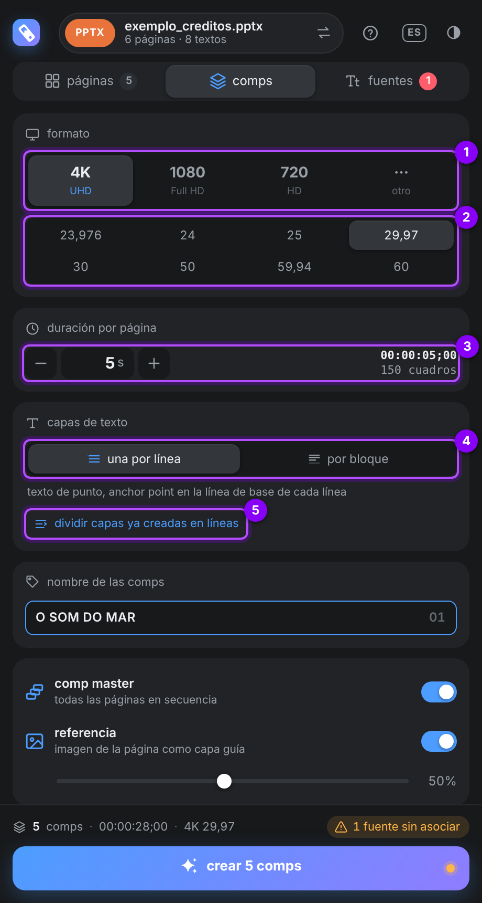</td>
    <td>

1. **formato** → `4K` (3840 × 2160), `1080` (1920 × 1080), `720` (1280 × 720) o `···` para un tamaño personalizado.
2. **frame rate** → predeterminado **29,97**.
3. **duración por página** → `−` / `+` de 0,5 s (o escríbela; `↑` `↓` también funcionan). al lado, el timecode y los cuadros.
4. **capas de texto**:
   - **una por línea** (predeterminado) → cada línea se convierte en una capa de **texto de punto**, con el **anchor point en [0, 0] en la línea de base**, en el punto de alineación (inicio, centro o final de la línea). nada se corta si la fuente nueva es más ancha.
   - **por bloque** → una capa por cuadro de texto de PowerPoint (*paragraph text*) o por párrafo del PDF.
5. **dividir capas ya creadas en líneas** → el mismo resultado del modo *una por línea*, aplicado después (ver [paso 7.5](#7--crear-las-comps)).

el pie resume todo: cantidad de comps, duración total, formato y frame rate.

  </td>
  </tr>
</table>

**5.2** más abajo y en **ajustes finos**:

<table>
  <tr>
    <td width="400">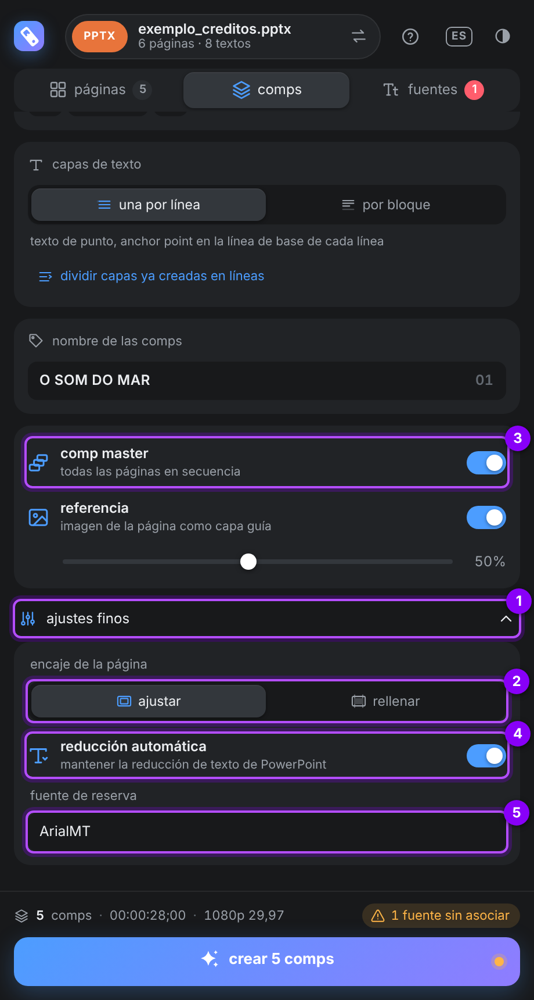</td>
    <td>

1. abre / cierra los ajustes finos.
2. **encaje de la página** → *ajustar* (página entera visible) o *rellenar* (recorta los bordes) cuando la proporción del documento es distinta de la de la comp.
3. **comp master** → todas las páginas en secuencia, con un marcador por página.<br>**referencia** → imagen de la página como **capa guía** bloqueada; al activarla, aparece la opacidad.
4. **reducción automática** (PPTX) → mantiene la reducción de texto que PowerPoint aplica cuando el texto no cabe en el cuadro.
5. **fuente de reserva** → nombre PostScript usado cuando una fuente no está asociada (predeterminado `ArialMT`).

  </td>
  </tr>
</table>

> 🚩 *nota:*\
> • la configuración queda guardada para la próxima vez.\
> • las capas guía no aparecen en el render final, ni cuando la comp se usa como precomp.

<br>

---

<br>

## 6 · asociar las fuentes

**6.1** la pestaña **fuentes** lista cada fuente del documento como **origen → destino**, con una vista previa del texto en la fuente de destino. el número rojo en la pestaña indica cuántas todavía **no tienen fuente**.

<table>
  <tr>
    <td width="400"></td>
    <td>

1. **3 fuentes sin asociar** (el documento usa *Gotham Black* y *Calibri*, que no están instaladas).
2. 🔴 **sin fuente** → si sigue así, la capa usa la **fuente de reserva**. las que faltan quedan arriba de la lista.
3. 🟢 **automático** → *Inter Bold* de PowerPoint se encontró y se asoció sola. 🔵 = **manual**, elegida por ti.
4. **vista previa** con el texto del propio documento, en la fuente de destino.
5.  **asociar automáticamente** de nuevo.
6.  **leer del proyecto** (ver [paso 8](#8--cambiar-las-fuentes-después)).

  </td>
  </tr>
</table>

**6.2** haz clic en una fuente para **abrirla** y cambiarla:

<table>
  <tr>
    <td width="400">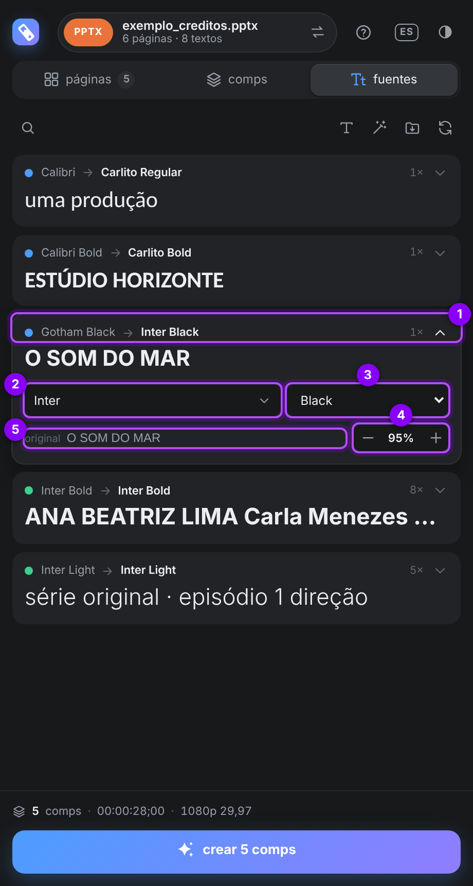</td>
    <td>

ejemplo: *Gotham Black* no está instalada → se cambió por **Inter Black**:

1. haz clic en la fila para abrirla (haz clic de nuevo, o en otra fuente, para cerrarla).
2. **familia** → haz clic y escribe para buscar (`Inter`). consulta el [selector de fuentes](#-selector-de-fuentes) más abajo.
3. **estilo** → `Black` (al cambiar la familia, el estilo más parecido al original ya viene elegido).
4. **escala** → `−` / `+` de 5 %. aquí `95 %`: la fuente nueva es un poco más ancha.
5. el texto en la fuente **original** (si está instalada), para comparar.

las *Calibri* no están instaladas, pero el panel ya las asoció por sí solo a **Carlito**, que tiene las **mismas medidas** (el texto ocupa el mismo espacio). esto vale para los pares conocidos — *Calibri → Carlito*, *Cambria → Caladea*, *Arial / Helvetica → Liberation Sans*, *Times New Roman → Liberation Serif*, *Courier New → Liberation Mono* — cuando la equivalente está instalada. el tooltip del punto avisa que es una equivalente; para usar otra fuente, basta cambiarla.

  </td>
  </tr>
</table>

#### 🔎 selector de fuentes

<table>
  <tr>
    <td width="400">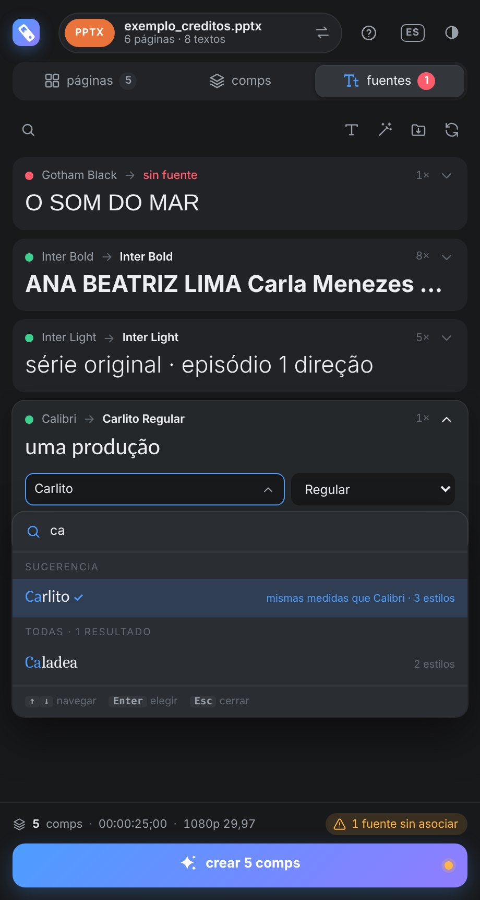</td>
    <td>

- escribe parte del nombre para filtrar; cada fuente aparece **dibujada en sí misma**;
- **sugerencia** → fuente instalada con las **mismas medidas** que la original (*Calibri → Carlito*, *Cambria → Caladea*, *Arial → Liberation Sans*…);
- **recientes** → las últimas familias elegidas quedan arriba;
- `↑` `↓` navegan, `Enter` elige, `Esc` cierra.

  </td>
  </tr>
</table>

después de cambiar una fuente, si el documento tiene **otros estilos de la misma familia** (p. ej. *Calibri* y *Calibri Bold*), el panel ofrece cambiarlos todos a la vez, manteniendo el peso de cada uno:

<p align="center">
  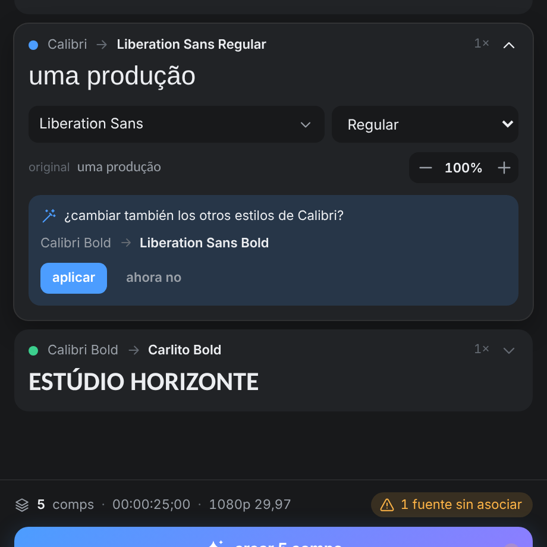
</p>

**6.3** para comparar con otro texto (acentos, números…), haz clic en  (1), escribe el **texto de vista previa** (2) y ajusta el **tamaño** (3):

<p align="center">
  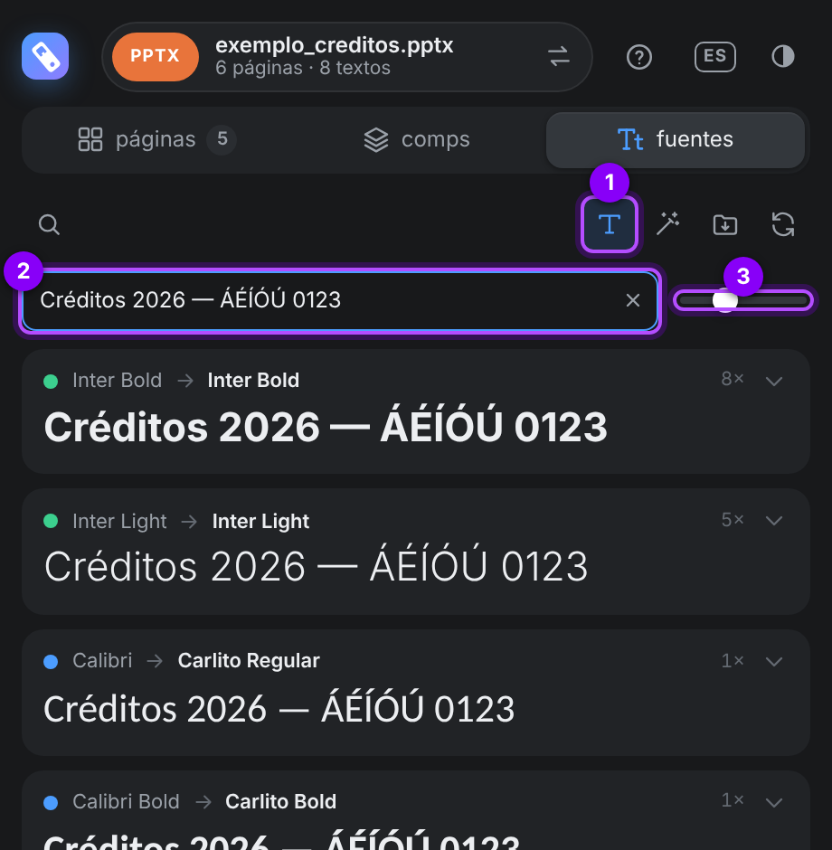
</p>

**6.4** la lista acompaña a las **páginas seleccionadas**. una fuente que solo aparece en páginas desmarcadas baja al grupo contraído **no usadas en las páginas seleccionadas**, al final de la lista. no entra en el aviso rojo de la pestaña y su asociación queda guardada. vuelve a marcar la página y la fuente regresa a su lugar. haz clic en el grupo para ver las fuentes que están ahí.

> 💡 *consejos:*\
> • las elecciones manuales quedan **memorizadas**: en el próximo documento con la misma fuente, la asociación ya viene lista.\
> •  recarga la lista de fuentes instaladas (útil después de activar una fuente en Adobe Fonts).\
> •  filtra por el nombre de la fuente del documento.

<br>

---

<br>

## 7 · crear las comps

**7.1** antes de crear, el panel avisa lo que puede salir mal. si alguna fuente usada en las páginas seleccionadas no está asociada, el pie muestra **⚠ N fuentes sin asociar** y el botón recibe un punto naranja. haz clic en el aviso para ir directo a la fuente que falta:

<p align="center">
  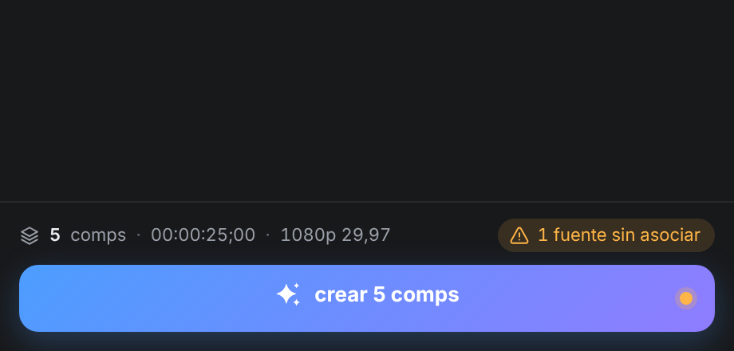
</p>

al hacer clic en **crear**, si hay algo que decidir, aparece la hoja **antes de crear**:

<table>
  <tr>
    <td width="400">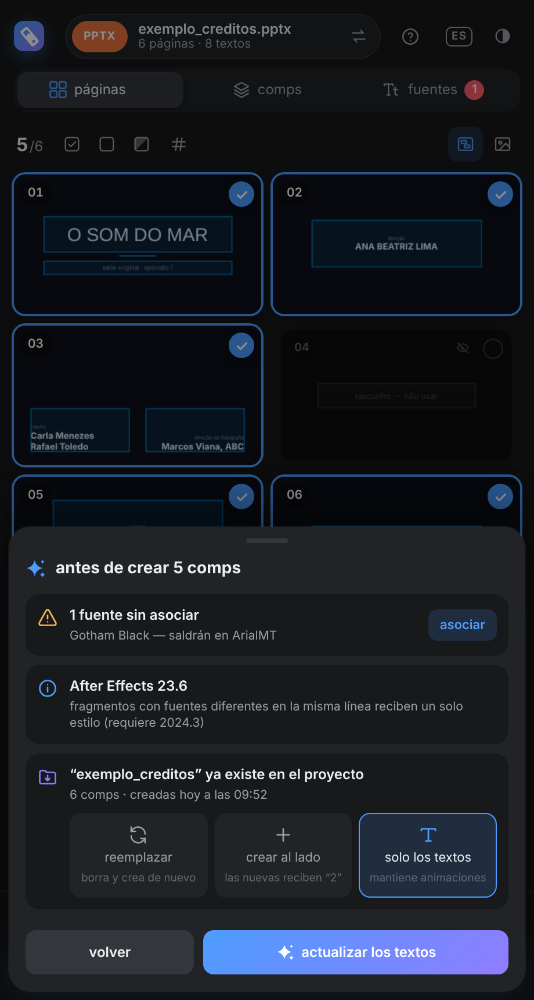</td>
    <td>

- ⚠ **fuentes sin asociar** → cuáles son y en qué fuente van a salir. **asociar** lleva a la pestaña fuentes, ya con la primera abierta.
- ⓘ **versión de After Effects** → solo aparece si AE es anterior a 2024 (24.3) y el documento tiene fragmentos con fuentes diferentes en la misma línea.
- 📁 **el documento ya existe en el proyecto** → elige:
  - **solo los textos** (predeterminado) → mantiene las comps, posiciones, animaciones y efectos y cambia solo el **contenido** de las capas de texto. los textos nuevos se convierten en capas nuevas; las capas que perdieron su texto se quedan y aparecen en los avisos;
  - **crear al lado** → mantiene las antiguas; las nuevas van a la carpeta “nombre 2” y las comps reciben “(2)”;
  - **reemplazar** → borra la carpeta y las comps antiguas del documento y las crea de nuevo.

`Enter` confirma, `Esc` vuelve. sin nada que decidir, el botón crea directamente.

  </td>
  </tr>
</table>

**7.2** haz clic en **crear N comps** (o **actualizar los textos**). el propio botón se convierte en la barra de progreso:

<p align="center">
  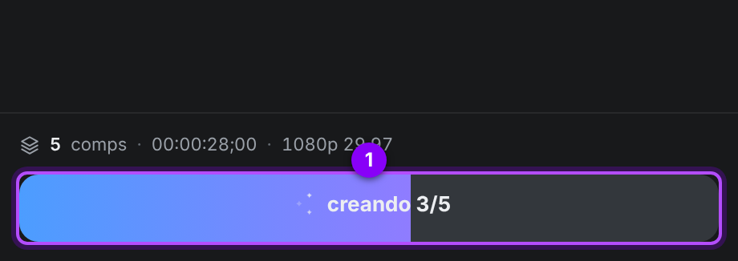
</p>

**7.3** al final, el botón se pone verde con un ✔, y un mensaje confirma cuántas comps se crearon (1). si hay **avisos**, aparece el ⚠ con la cantidad (2):

<p align="center">
  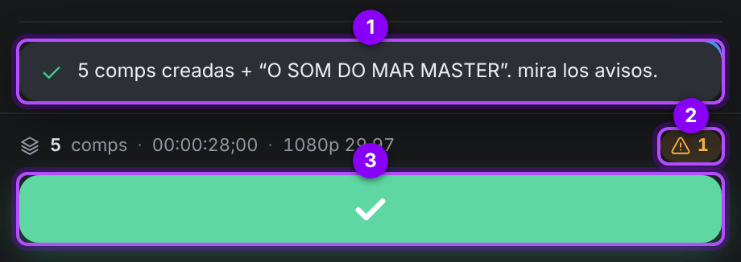
</p>

el aviso final tiene atajos para **abrir master** y **mostrar en el proyecto** (selecciona la carpeta del documento en el panel *Project* (*Proyecto*)):

<p align="center">
  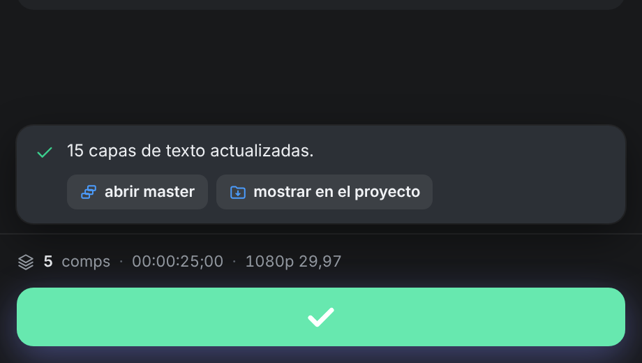
</p>

haz clic en el ⚠ para ver la lista:

<p align="center">
  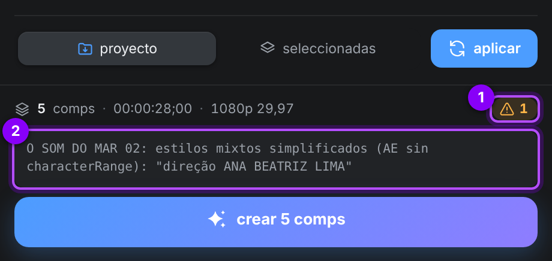
</p>

avisos comunes:
- `fuente "X" no disponible (…) → ArialMT` → la fuente elegida no está instalada en esta máquina y la capa usó la de reserva;
- `estilos mixtos simplificados` → la capa tiene fuentes/tamaños diferentes, pero la versión de After Effects es anterior a 2024 (24.3), así que recibió un solo estilo.

**7.4** en el proyecto, ABRIDOR crea (los nombres de las carpetas `slides` y `referências` —«referencias»— están en portugués):

```
📁 ABRIDOR
 └─ 📁 exemplo_creditos            ← una carpeta por documento
     ├─ 🎞 O SOM DO MAR MASTER      ← todas las páginas en secuencia, con marcadores
     ├─ 📁 referências              ← imágenes de las páginas (PNG)
     └─ 📁 slides
         ├─ 🎞 O SOM DO MAR 01      ← una comp por página seleccionada
         ├─ 🎞 O SOM DO MAR 02
         └─ …
```

en cada comp de página: las **capas de texto**, con el nombre del propio texto, y debajo la **REF**, la capa guía bloqueada con la imagen de la página (ver la [ilustración de arriba](#-abridor)).

**7.5** para dividir en líneas capas que ya existen (creadas *por bloque*, por una versión anterior de ABRIDOR o incluso escritas a mano):

1. selecciona las **capas de texto** en la comp activa — o selecciona **comps** en el panel *Project* para dividir todas sus capas de texto;
2. en la pestaña **comps**, haz clic en **dividir capas ya creadas en líneas**.

cada línea se convierte en una capa de texto de punto con el anchor point en cero en la línea de base, en el mismo lugar, con los mismos colores, fuentes, escala, rotación, primario y tiempo. las capas con keyframes o expresión en el texto se omiten (aparecen en los avisos). `Edición` > `Deshacer` (`Edit` > `Undo`) lo deshace todo de una vez.

> 🚩 *nota:*\
> • las imágenes de referencia se guardan en una carpeta `<nombre del documento>_ABRIDOR` junto al documento (o en la carpeta temporal, si no es posible escribir ahí o si el archivo se arrastró sin una ruta conocida).\
> • cada etapa se puede deshacer con `Edición` > `Deshacer`.\
> • la columna **Comentario** (**Comment**) de las capas de texto guarda la fuente original (`ABRIDOR {...}`). **no borres** ese comentario si quieres cambiar las fuentes después.

<br>

---

<br>

## 8 · cambiar las fuentes después

las capas creadas por ABRIDOR recuerdan la fuente original de cada fragmento. por eso las fuentes se pueden cambiar **en cualquier momento** — el mismo día o meses después, con el documento original o sin él.

**8.1** abre el proyecto y ve a la pestaña **fuentes**. sin un documento abierto, usa **leer del proyecto** (1):

<p align="center">
  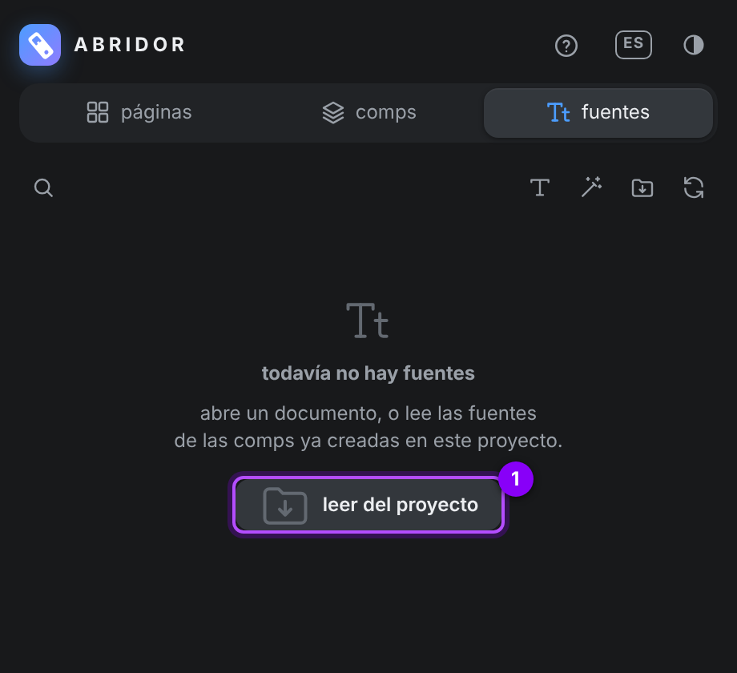
</p>

**8.2** aparecen las fuentes de las capas ya creadas, con la última asociación usada. cambia lo que quieras y aplica:

<table>
  <tr>
    <td width="400">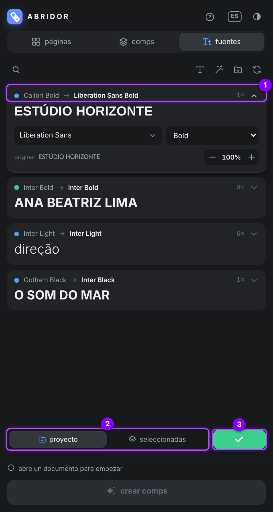</td>
    <td>

1. cambia la fuente (aquí *Calibri Bold* → **Liberation Sans Bold**).
2. elige dónde aplicar:
   - **proyecto** → en todas las comps del proyecto;
   - **seleccionadas** → solo en las comps seleccionadas en el panel *Project*.
3. **aplicar** → el botón confirma con ✔ cuando termina.

la barra **aplicar** solo aparece cuando hay comps de ABRIDOR en el proyecto (después de crear o de leer del proyecto).

  </td>
  </tr>
</table>

> 🚩 *nota:*\
> • el cambio conserva los tamaños ajustados a mano (excepto en capas con fuentes mezcladas, que vuelven al tamaño original × escala).\
> • también funciona con keyframes de *Texto de origen* (*Source Text*).

<br>

---

<br>

## 💡 consejos y problemas comunes

**el panel no aparece en `Ventana` > `Extensiones` (`Window` > `Extensions`).**\
reinicia After Effects después de instalar. en macOS, reinicia también la computadora. verifica que la carpeta `com.abridor.panel` exista en:
- Windows: `%APPDATA%\Adobe\CEP\extensions\`
- macOS: `~/Library/Application Support/Adobe/CEP/extensions/`

**una página del PDF aparece con 0 textos (o le faltan textos).**\
el texto está como **imagen** o se convirtió en **curvas** en el PDF. no hay forma de extraerlo: escribe ese texto en After Effects o pide el PPTX original.

**quiero una referencia idéntica a PowerPoint.**\
la referencia de PPTX es un render aproximado (fondo, imágenes, formas y textos). para que quede idéntica:
1. en PowerPoint, `Archivo` > `Exportar` > `Cambiar el tipo de archivo` > `PNG` (todas las diapositivas);
2. en ABRIDOR, pestaña **páginas** > **imágenes externas…** y elige la carpeta de los PNG. las imágenes se asocian por el orden numérico de los archivos (`Slide1.png`, `Slide2.png`, …) y las páginas reciben la etiqueta **IMG**. la **×** vuelve a la referencia interna.

o guarda el PPTX como PDF y usa el PDF.

**el texto quedó más ancho / se partió en más líneas que en el documento.**\
la fuente sustituta es más ancha que la original. ajusta la **escala** de la fuente en la pestaña **fuentes** y vuelve a aplicar. los cuadros de texto se crean con holgura extra en la altura para no cortar líneas.

**PDF: quería una capa por línea.**\
pestaña **comps** > **capas de texto** > **una por línea**. el documento se vuelve a leer al instante.

**PPTX: el texto es más pequeño que en PowerPoint.**\
PowerPoint reduce el texto cuando no cabe en el cuadro (*reducción automática*), y ABRIDOR copia esa reducción. para usar el tamaño original, desactiva **reducción automática** (*mantener la reducción de texto de PowerPoint*) en **ajustes finos**, en la pestaña **comps**.

### 📋 versiones de After Effects

| función | versión mínima |
| --- | --- |
| panel, creación de las comps, cambio de fuentes | **2020 (17.0)** |
| lista de fuentes instaladas, asociación automática y vista previa | **2024 (24.0)** — antes de eso, escribe el nombre PostScript |
| fuentes / tamaños / colores diferentes **en la misma capa** | **2024 (24.3)** — antes de eso, la capa usa el estilo predominante |

<br>

---

<br>

## 🔍 cómo se recrean los textos

| | **PPTX** | **PDF** |
| --- | --- | --- |
| tipo de capa | *una por línea*: texto de punto por línea, anchor en la línea de base · *por bloque*: cuadro de texto del tamaño del cuadro de PowerPoint | *una por línea*: texto de punto por línea · *por bloque*: texto de punto por párrafo; anchor siempre en la **línea de base** exacta |
| alineación | horizontal (izq. / centro / der. / justificado) y vertical (arriba / medio / abajo) | detectada por la geometría de las líneas |
| fuente / tamaño / color | heredados de diapositiva → diseño → patrón → tema | nombre PostScript incrustado, tamaño y color exactos del PDF |
| interlineado | modelo de PowerPoint: 1,2 × tamaño × espaciado, 1.ª línea de base a (interlineado − 0,2 × tamaño) desde arriba, espacio antes/después del párrafo, alineación vertical del cuadro (incl. reducción automática) | distancia medida entre las líneas |
| otros | rotación, grupos, tablas, marcadores de posición, mayúsculas, espaciado entre letras | rotación, fragmentos con colores / fuentes diferentes |

<br>

---

<br>

## 🌐 idiomas y traducciones

el panel, los mensajes de After Effects y el instalador están en **português**, **English** y **español**.

- **en el panel:** el botón **PT / EN / ES** de arriba cambia el idioma al instante, sin perder el documento abierto. la elección queda guardada. la primera vez, el panel usa el idioma de After Effects (si no es ninguno de los tres, usa el inglés).
- **en el instalador:** sigue el idioma de After Effects.

todos los textos están en un solo archivo: **`abridor-cep/i18n/strings.csv`** — una fila por texto, una columna por idioma. se puede abrir en Excel, en Google Sheets o en un editor de texto:

```
key,pt,en,es
app.cta.createAll,criar comps,create comps,crear comps
app.pages.one,{n} página,{n} page,{n} página
app.pages.other,{n} páginas,{n} pages,{n} páginas
```

- **corregir una traducción:** edita la celda en la carpeta de ABRIDOR y vuelve a ejecutar el instalador (o edita directamente el `strings.csv` de la extensión instalada) y vuelve a abrir el panel.
- **nuevo idioma:** agrega una columna con el código de 2 letras (p. ej.: `fr`) y complétala. aparece de inmediato en el botón de idioma y en el instalador. una celda vacía usa el portugués.
- `{nombre}` se reemplaza por un valor (número de páginas, nombre de la fuente…) — mantenlo igual en todas las columnas.
- las claves que terminan en `.one` / `.other` son singular y plural.
- `\n` es salto de línea; las filas que empiezan con `#` son comentarios.
- el separador puede ser coma o punto y coma (Excel en portugués o en español suele guardar con `;`). guarda siempre en **UTF-8**.

> ⚠️ *nota:* los prefijos indican dónde aparece el texto: `panel.*` y `app.*` en el panel, `tour.*` en el recorrido guiado, `err.*` / `parser.*` en errores y nombres de página, `host.*` en los avisos y en el historial de deshacer de After Effects, `inst.*` en el instalador.

<br>

---

<br>

## 🛠 desarrollo

```
abridor-cep/
├── CSXS/manifest.xml     → manifiesto CEP (AEFT 17+)
├── index.html            → interfaz
├── css/style.css
├── js/
│   ├── i18n.js           → traducciones (lee i18n/strings.csv)
│   ├── cep.js            → puente con AE (evalScript) y sistema de archivos (Node)
│   ├── ui.js             → íconos, animaciones de expandir/contraer, segmentados, toasts
│   ├── pptx-parser.js    → lectura del PPTX (zip + XML)
│   ├── pdf-parser.js     → lectura del PDF (pdf.js)
│   ├── render.js         → miniaturas / referencia de PPTX
│   ├── fonts.js          → fuentes instaladas, asociación automática, vista previa
│   ├── app.js            → lógica del panel
│   └── lib/              → JSZip 3.10.1, pdf.js 3.11.174 (legacy)
└── jsx/host.jsx          → creación de las comps y cambio de fuentes (ExtendScript)
```

- depuración: con el panel abierto en AE, entra a `http://localhost:8099` en Chrome (archivo `.debug`).
- pruebas fuera de After Effects (Node + Playwright):
  - todas las pruebas del panel aceptan `ABR_LANG=en` o `ABR_LANG=es` (predeterminado `pt-BR`), p. ej.: `ABR_LANG=en node tests/run_panel.js …`. `tests/pw.js` prepara Playwright (idioma y acceso al CSV).
  - `node tests/run_panel.js <arquivo.pptx|pdf> <saída>` → abre el panel en Chromium con AE simulado, extrae y genera el job.
  - `node tests/host_mock.js <saída>/job.json <saída>/host` → ejecuta `host.jsx` contra un mock de After Effects y dibuja las capas sobre la referencia.
  - `node tests/tour_check.js <saída>` → verifica el recorrido guiado: primera vez, pasos, teclado, botón **?** y tour sin documento (con `--docs`, guarda las capturas del README).
  - `node tests/features_check.js <saída>` → verifica en el panel la revisión antes de crear, el selector de fuentes, el cambio de familia, shift+clic, las acciones del final y los recientes (con `--docs`, guarda las capturas del README).
  - `MODES=new,texts,side,replace node tests/host_mock.js …` → ejecuta los modos de creación en secuencia en el mock de After Effects.
  - `node tests/installer_mock.js <pasta temporária>` → ejecuta el instalador con File/Folder/ScriptUI simulados (instala y elimina).
  - `node tests/ux_walk.js <saída>` → recorrido de uso real (primera vez con el tour, un PDF real, panel angosto; `W=` y `H=` cambian el tamaño); `node tests/ux_sizes.js <saída>` → panel en tamaños extremos; `node tests/ux_edge.js <saída>` → errores y entradas no válidas (archivo dañado, fallo de After Effects, límites de los campos, reabrir el panel).
  - `python3 tests/make_test_pptx.py <arquivo.pptx>` → genera un PPTX con casos variados.
- capturas del README:
  - `python3 tests/make_example_pptx.py` → genera `exemplo_creditos.pptx`.
  - `node tests/make_screenshots.js` → genera todas las capturas de `docs/img` (panel real en Chromium con AE simulado; el instalador, el menú y el proyecto son ilustraciones en `tests/illustrations.html`).
  - `node tests/make_demo.js` → graba la animación `docs/img/demo.gif` (requiere `ffmpeg`).
  - capturas en otros idiomas: ejecuta `make_screenshots.js`, `make_demo.js`, `features_check.js <saída> --docs` y `tour_check.js <saída> --docs` con `ABR_LANG=en` o `ABR_LANG=es` → van a `docs/img/en/` y `docs/img/es/` (mismos nombres de archivo).
  - `python3 tests/make_micro_css.py` → genera `css/micro.css`, las microinteracciones de hover de cada ícono.
  - `node tests/micro_preview.js <saída>` → graba el catálogo de las microinteracciones y el panel en uso (GIF, requiere `ffmpeg`).
  - `node tests/make_banner.js` → genera el banner del instalador (con el logo) y escribe la cadena ExtendScript en el instalador.
- `js/lib/pdf.js` y `pdf.worker.js` tienen una modificación: `isNodeJS = false`, porque CEP expone `process` y pdf.js intentaría usar APIs de Node.
