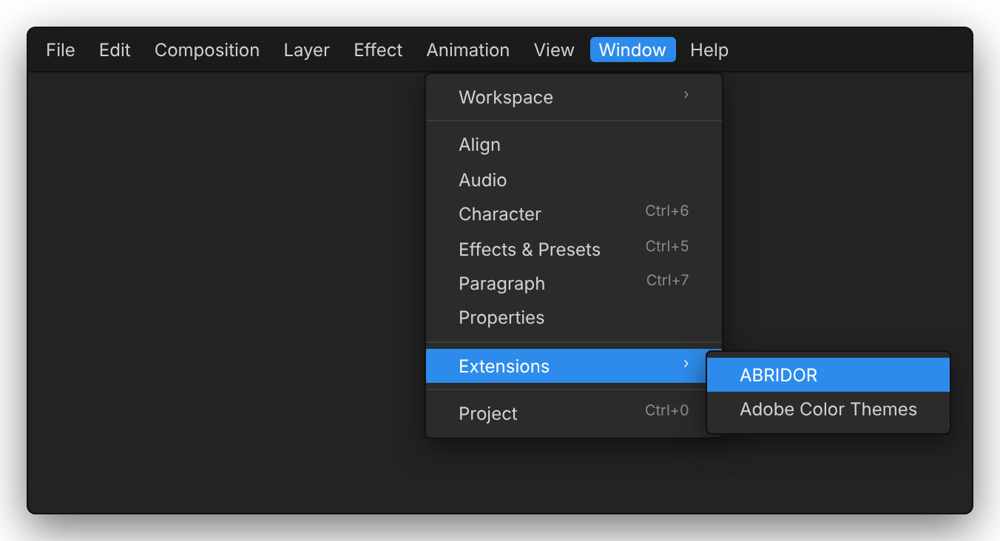
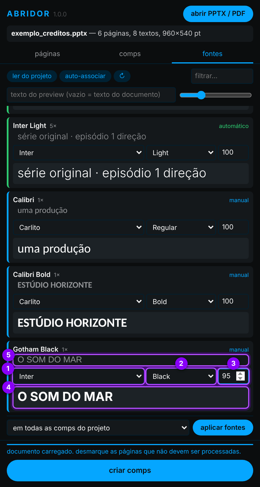
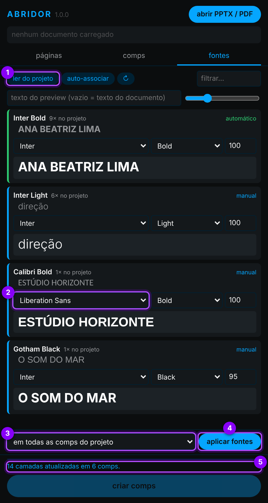

# 🧾 ABRIDOR

🗨️ **pt-BR** ⚡ Extensão do After Effects para agilizar a criação dos layouts de uma abertura ⚡

O **ABRIDOR** lê arquivos **PPTX** e **PDF** diretamente — sem conversões nem sites externos — e recria cada página/slide como uma comp do After Effects, com os textos o mais fiéis possível ao original: posição, alinhamento, tamanho, entrelinha, cor, rotação e fontes. As fontes do documento podem ser trocadas por outras, com preview, **antes ou depois** de criar as comps.

<p align="center">
  
  <br><sub><i>ilustração: o que o ABRIDOR cria no projeto — uma comp por página, a comp master em sequência e as referências.</i></sub>
</p>

<br>

## 📑 índice

1. [instalar](#1--instalar)
2. [abrir o painel](#2--abrir-o-painel)
3. [abrir o documento](#3--abrir-o-documento)
4. [escolher as páginas](#4--escolher-as-páginas)
5. [configurar as comps](#5--configurar-as-comps)
6. [associar as fontes](#6--associar-as-fontes)
7. [criar as comps](#7--criar-as-comps)
8. [trocar as fontes depois](#8--trocar-as-fontes-depois)
9. [dicas e problemas comuns](#-dicas-e-problemas-comuns)
10. [como os textos são recriados](#-como-os-textos-são-recriados)

> 📂 **arquivos:**\
> • **INSTALAR O ABRIDOR.jsx** → instalador (roda dentro do After Effects).\
> • **abridor-cep/** → a extensão (painel CEP).\
> • **instalar_windows.bat** / **instalar_mac.command** → instaladores alternativos, sem abrir o After Effects.\
> • **test files/exemplo_creditos.pptx** → PPTX de exemplo para testar (é o usado nos prints abaixo).\
> • **ABRIDOR 0.2b.jsxbin** → versão anterior (script que dependia do JSON do site da Adobe).

<br>

---

<br>

## 1 · instalar

> ✅ **requisitos:** After Effects **2020 (17.0)** ou mais novo. recomendado o **2024 (24.3)** ou mais novo — veja a [tabela de versões](#-versões-do-after-effects).

**1.1** no After Effects, abra `File` > `Scripts` > `Run Script File...` e escolha o **INSTALAR O ABRIDOR.jsx** direto da pasta do ABRIDOR (a pasta que tem a `abridor-cep` dentro). o instalador abre com as boas-vindas — clique em **começar**.

**1.2** o instalador confere o que é necessário. bolinha 🟢 = ok, 🟡 = funciona com limitações, 🔴 = precisa resolver. se a escrita de arquivos estiver bloqueada, use o link **› abrir preferências de scripts e expressões**, marque *Allow Scripts to Write Files and Access Network* e clique em **› verificar de novo**.

<table>
  <tr>
    <td align="center"><br><sub>1.1 · boas-vindas</sub></td>
    <td align="center"><br><sub>1.2 · checagem</sub></td>
  </tr>
</table>

**1.3** escolha **instalar** (ou **atualizar** / **reinstalar**, se já houver uma versão no computador; **remover** desinstala). a tela mostra de onde a extensão vai ser copiada e para onde.

**1.4** pronto! **reinicie o After Effects**.

<table>
  <tr>
    <td align="center"><br><sub>1.3 · ação</sub></td>
    <td align="center"><br><sub>1.4 · concluído</sub></td>
  </tr>
</table>

<sub><i>ilustrações da janela do instalador.</i></sub>

> 🚩 *obs:*\
> • a instalação é **sempre local**: a pasta `abridor-cep` inteira é copiada para a pasta de extensões do usuário. depois disso o ABRIDOR não depende mais da pasta de origem (rede, pendrive ou download). para atualizar, rode o instalador da versão nova.\
> • a extensão não é assinada, por isso o instalador habilita o `PlayerDebugMode` do CEP.\
> • **macOS:** se o painel não aparecer depois de reiniciar o After Effects, reinicie o computador.

<br>

---

<br>

## 2 · abrir o painel

**2.1** no After Effects, abra `Window` > `Extensions` > `ABRIDOR`. o painel pode ser encaixado em qualquer lugar da área de trabalho, como os outros painéis.

<p align="center">
  <br>
  <sub><i>ilustração do menu do After Effects.</i></sub>
</p>

**2.2** o painel abre vazio. ele tem:

<table>
  <tr>
    <td width="400"></td>
    <td>

1. **abrir PPTX / PDF** → escolhe o documento.
2. **abas** → `páginas`, `comps` e `fontes`.
3. **criar comps** → cria tudo no projeto (fica ativo depois de abrir um documento).

no rodapé aparecem o andamento e os avisos. ao abrir, o painel já lê a lista de fontes instaladas (*pronto — N fontes instaladas*).

  </td>
  </tr>
</table>

<br>

---

<br>

## 3 · abrir o documento

**3.1** clique em **abrir PPTX / PDF** e escolha o arquivo. cada página aparece em miniatura, com os textos detectados destacados por cima.

<table>
  <tr>
    <td align="center"><br><sub>PPTX: <code>exemplo_creditos.pptx</code></sub></td>
    <td align="center"><br><sub>PDF: template de créditos</sub></td>
  </tr>
</table>

no **PPTX** (à esquerda):

1. slides marcados como **ocultos** no PowerPoint já vêm **desmarcados**.
2. **duração só desta página** → aqui o slide 1 vai durar 8 s; vazio = duração padrão (aba `comps`).
3. **imagens externas…** → usa PNG/JPG exportados do PowerPoint como referência (ver [dicas](#-dicas-e-problemas-comuns)).

no **PDF** (à direita):

1. nome do arquivo, número de páginas, de textos e tamanho da página.
2. **mostrar textos detectados** liga/desliga os destaques: 🟦 **azul** = caixa de texto, 🟧 **laranja** = texto de ponto.
3. contador de páginas selecionadas.
4. a página 1 foi **desmarcada** com um clique: o título dela é uma **imagem** dentro do PDF (só o "globo" é texto), então não vale a pena processar.
5. passe o mouse sobre a miniatura para ver a lista de textos encontrados.

**3.2** cada destaque vira **uma camada de texto**. abaixo, a mesma detecção em tamanho grande, com a fonte, o tamanho e o alinhamento que o ABRIDOR leu de cada bloco:

<p align="center">
  <br>
  <sub>PDF: blocos à esquerda e à direita detectados pela geometria das linhas, com a fonte e o tamanho exatos de cada um.</sub>
</p>

<table>
  <tr>
    <td align="center"><br><sub>PDF: parágrafos de várias linhas agrupados em uma camada.</sub></td>
    <td align="center"><br><sub>PPTX: caixas do PowerPoint (alinhadas na base, à esquerda e à direita).</sub></td>
  </tr>
</table>

<br>

---

<br>

## 4 · escolher as páginas

**4.1** clique na **miniatura** (ou na caixa de seleção) para incluir ou excluir a página. as excluídas ficam apagadas e não viram comps.

<p align="center">
  <br>
  <sub>página selecionada: borda azul, caixa marcada, quantidade de textos e campo de duração.</sub>
</p>

**4.2** para seleções maiores:

<table>
  <tr>
    <td width="400"></td>
    <td>

- **todas / nenhuma / inverter** → seleção rápida.

1. digite um **intervalo** de páginas:
   - `1-3, 5` → páginas 1, 2, 3 e 5
   - `8-` → da 8 até o fim
   - `-4` → da 1 até a 4
2. clique em **ok** (ou tecle `Enter`): ficam selecionadas **somente** essas páginas.
3. o contador confirma: *4 de 6 páginas selecionadas*.

  </td>
  </tr>
</table>

<br>

---

<br>

## 5 · configurar as comps

**5.1** na aba **comps**:

<table>
  <tr>
    <td width="400"></td>
    <td>

1. **resolução** → `UHD 4K 3840 × 2160`, `Full HD 1920 × 1080`, `HD 1280 × 720` ou *personalizada*.
2. **frame rate** → padrão **29,97**. também 23,976 · 24 · 25 · 30 · 50 · 59,94 · 60.
3. **duração por página** (em segundos), com o timecode e os frames ao lado.
4. **total** da sequência, já somando as durações individuais (aqui o slide 1 com 8 s).
5. **nome** das comps → `O SOM DO MAR 01`, `O SOM DO MAR 02`, …
6. **comp master** → todas as páginas em sequência, com um marcador por página.
7. **imagem de referência** → render da página como **camada guia** travada, com opacidade ajustável.

ainda nesta aba:

- **encaixe** → *ajustar* (página inteira visível) ou *preencher* (corta as bordas) quando a proporção do documento for diferente da comp.
- **PDF** → *agrupar linhas em parágrafos* ou *uma camada por linha*.
- **PPTX** → *ignorar a redução automática de texto* do PowerPoint.
- **fonte reserva** → nome PostScript usado quando uma fonte não estiver associada (padrão `ArialMT`).

  </td>
  </tr>
</table>

> 🚩 *obs:*\
> • as configurações ficam salvas para a próxima vez.\
> • camadas guia não aparecem no render final, nem quando a comp é usada como precomp.

<br>

---

<br>

## 6 · associar as fontes

**6.1** a aba **fontes** lista as fontes do documento, com quantas vezes cada uma aparece **nas páginas selecionadas**. o número vermelho na aba indica quantas ainda **não têm fonte**.

<table>
  <tr>
    <td width="400"></td>
    <td>

1. **3 fontes sem associação** (o documento usa *Gotham Black* e *Calibri*, que não estão instaladas).
2. 🔴 **vermelho** = não encontrada. se continuar assim, a camada usa a **fonte reserva**.
3. 🟢 **verde** = associada **automaticamente**: *Inter Bold* do PowerPoint → família *Inter*, estilo *Bold*.

cada fonte mostra:
- em **cinza**, o texto do documento na fonte **original** (se ela estiver instalada);
- no quadro escuro, o mesmo texto na fonte **escolhida**.

  </td>
  </tr>
</table>

**6.2** para trocar, escolha **família** e **estilo**. a linha fica 🔵 **azul** (*manual*).

<table>
  <tr>
    <td width="400"></td>
    <td>

exemplo: *Gotham Black* não está instalada → trocada por **Inter Black**:

1. **família** → `Inter`
2. **estilo** → `Black` (ao trocar a família, o estilo mais parecido com o original já vem escolhido)
3. **escala** → `95` %: a fonte nova é um pouco mais larga, então o texto fica 5 % menor
4. **preview** com a fonte nova
5. texto original do documento

as *Calibri* foram associadas à **Carlito**, que tem as mesmas medidas.

  </td>
  </tr>
</table>

**6.3** para comparar as fontes com outro texto (acentos, números…), digite no campo **texto do preview** (1). o controle deslizante (2) muda o tamanho do preview.

<p align="center">
  
</p>

> 💡 *dicas:*\
> • as escolhas manuais ficam **memorizadas**: no próximo documento com a mesma fonte, a associação já vem pronta.\
> • **auto-associar** refaz as associações automáticas; **↻** recarrega a lista de fontes instaladas (útil depois de ativar uma fonte nova no Adobe Fonts).\
> • **filtrar…** procura pelo nome da fonte do documento.

<br>

---

<br>

## 7 · criar as comps

**7.1** clique em **criar comps**. o andamento aparece no rodapé, comp por comp:

<p align="center">
  
</p>

**7.2** no fim, o rodapé mostra quantas comps foram criadas. se houver **avisos**, clique no botão para ver a lista. avisos comuns:
- `fonte "X" indisponível (…) → ArialMT` → a fonte escolhida não está instalada nesta máquina e a camada usou a reserva;
- `estilos mistos simplificados` → a camada tem fontes/tamanhos diferentes, mas a versão do After Effects é anterior à 2024 (24.3), então recebeu um estilo só (exemplo abaixo).

<p align="center">
  
</p>

**7.3** no projeto, o ABRIDOR cria:

```
📁 ABRIDOR
 └─ 📁 exemplo_creditos            ← uma pasta por documento
     ├─ 🎞 O SOM DO MAR MASTER      ← todas as páginas em sequência, com marcadores
     ├─ 📁 referências              ← imagens das páginas (PNG)
     └─ 📁 slides
         ├─ 🎞 O SOM DO MAR 01      ← uma comp por página selecionada
         ├─ 🎞 O SOM DO MAR 02
         └─ …
```

em cada comp de página: as **camadas de texto**, com o nome do próprio texto, e por baixo a **REF**, a camada guia travada com a imagem da página (veja a [ilustração no topo](#-abridor)).

> 🚩 *obs:*\
> • as imagens de referência são salvas numa pasta `<nome do documento>_ABRIDOR` ao lado do documento (ou na pasta temporária, se não for possível gravar lá).\
> • cada etapa pode ser desfeita com `Edit` > `Undo`.\
> • a coluna **Comment** das camadas de texto guarda a fonte original (`ABRIDOR {...}`). **não apague** esse comentário se quiser trocar as fontes depois.

<br>

---

<br>

## 8 · trocar as fontes depois

as camadas criadas pelo ABRIDOR lembram a fonte original de cada trecho. por isso as fontes podem ser trocadas **a qualquer momento** — no mesmo dia ou meses depois, com o documento original ou sem ele.

<table>
  <tr>
    <td width="400"></td>
    <td>

1. abra o projeto, vá na aba **fontes** e clique em **ler do projeto**: aparecem as fontes das camadas já criadas e o último mapeamento usado (*N× no projeto*).
2. troque as fontes que quiser (aqui *Calibri Bold* → **Liberation Sans Bold**).
3. escolha onde aplicar:
   - **em todas as comps do projeto**, ou
   - **nas comps selecionadas** (selecione as comps no painel *Project* antes).
4. clique em **aplicar fontes**.
5. o rodapé mostra quantas camadas foram atualizadas.

  </td>
  </tr>
</table>

> 🚩 *obs:*\
> • a troca preserva os tamanhos ajustados à mão (exceto em camadas com fontes misturadas, que voltam ao tamanho original × escala).\
> • funciona também com keyframes de *Source Text*.\
> • **duplo clique** no nome de uma fonte seleciona, na comp ativa, as camadas que usam essa fonte.

<br>

---

<br>

## 💡 dicas e problemas comuns

**o painel não aparece em `Window` > `Extensions`.**\
reinicie o After Effects depois de instalar. no macOS, reinicie também o computador. confira se a pasta `com.abridor.panel` existe em:
- Windows: `%APPDATA%\Adobe\CEP\extensions\`
- macOS: `~/Library/Application Support/Adobe/CEP/extensions/`

**uma página do PDF aparece com 0 textos (ou faltando textos).**\
o texto está como **imagem** ou foi convertido em **curvas** no PDF. não há como extrair: digite esse texto no After Effects ou peça o PPTX original.

**quero uma referência idêntica ao PowerPoint.**\
a referência de PPTX é um render aproximado (fundo, imagens, formas e textos). para ficar idêntica:
1. no PowerPoint, `Arquivo` > `Exportar` > `PNG` (todos os slides);
2. no ABRIDOR, aba **páginas** > **imagens externas…** e escolha a pasta dos PNGs. as imagens são associadas pela ordem numérica dos arquivos (`Slide1.png`, `Slide2.png`, …) e as páginas ganham a etiqueta **IMG**. o **×** volta para a referência interna.

ou salve o PPTX como PDF e use o PDF.

**o texto ficou mais largo / quebrou em mais linhas que no documento.**\
a fonte substituta é mais larga que a original. ajuste a **escala** da fonte na aba **fontes** e aplique de novo. as caixas de texto são criadas com folga extra na altura para não cortar linhas.

**PDF: queria uma camada por linha.**\
aba **comps** > **textos** > *uma camada por linha*. o documento é relido na hora.

**PPTX: o texto está menor que no PowerPoint.**\
o PowerPoint reduz o texto quando ele não cabe na caixa (*redução automática*), e o ABRIDOR copia essa redução. para usar o tamanho original, marque **ignorar a redução automática de texto do PowerPoint** na aba **comps**.

### 📋 versões do After Effects

| recurso | versão mínima |
| --- | --- |
| painel, criação das comps, troca de fontes | **2020 (17.0)** |
| lista de fontes instaladas, associação automática e preview | **2024 (24.0)** — antes disso, digite o nome PostScript |
| fontes / tamanhos / cores diferentes **na mesma camada** | **2024 (24.3)** — antes disso, a camada usa o estilo predominante |

<br>

---

<br>

## 🔍 como os textos são recriados

| | **PPTX** | **PDF** |
| --- | --- | --- |
| tipo de camada | caixa de texto (*paragraph text*) do tamanho da caixa do PowerPoint, sem as margens internas | texto de ponto ancorado na **linha de base** exata da 1ª linha |
| alinhamento | horizontal (esq. / centro / dir. / justificado) e vertical (topo / meio / base) | detectado pela geometria das linhas |
| fonte / tamanho / cor | herdados de slide → layout → mestre → tema | nome PostScript embutido, tamanho e cor exata do PDF |
| entrelinha | espaçamento de linha do PowerPoint (incl. redução automática) | distância medida entre as linhas |
| outros | rotação, grupos, tabelas, placeholders, maiúsculas, espaçamento entre letras | rotação, trechos com cores / fontes diferentes |

<br>

---

<br>

## 🛠 desenvolvimento

```
abridor-cep/
├── CSXS/manifest.xml     → manifesto CEP (AEFT 17+)
├── index.html            → interface
├── css/style.css
├── js/
│   ├── cep.js            → ponte com o AE (evalScript) e sistema de arquivos (Node)
│   ├── pptx-parser.js    → leitura do PPTX (zip + XML)
│   ├── pdf-parser.js     → leitura do PDF (pdf.js)
│   ├── render.js         → miniaturas / referência de PPTX
│   ├── fonts.js          → fontes instaladas, associação automática, preview
│   ├── app.js            → lógica do painel
│   └── lib/              → JSZip 3.10.1, pdf.js 3.11.174 (legacy)
└── jsx/host.jsx          → criação das comps e troca de fontes (ExtendScript)
```

- depuração: com o painel aberto no AE, acesse `http://localhost:8099` no Chrome (arquivo `.debug`).
- testes fora do After Effects (Node + Playwright):
  - `node tests/run_panel.js <arquivo.pptx|pdf> <saída>` → abre o painel no Chromium com o AE simulado, extrai e gera o job.
  - `node tests/host_mock.js <saída>/job.json <saída>/host` → executa o `host.jsx` contra um mock do After Effects e desenha as camadas sobre a referência.
  - `node tests/installer_mock.js <pasta temporária>` → executa o instalador com File/Folder/ScriptUI simulados (instala e remove).
  - `python3 tests/make_test_pptx.py <arquivo.pptx>` → gera um PPTX com casos variados.
- prints do README:
  - `python3 tests/make_example_pptx.py` → gera o `exemplo_creditos.pptx`.
  - `node tests/make_screenshots.js` → gera todos os prints de `docs/img` (painel real no Chromium com o AE simulado; instalador, menu e projeto são ilustrações em `tests/illustrations.html`).
  - `python3 tests/make_banner.py` → gera o banner do instalador como string ExtendScript.
- `js/lib/pdf.js` e `pdf.worker.js` têm uma alteração: `isNodeJS = false`, porque o CEP expõe `process` e o pdf.js tentaria usar APIs do Node.

<br>

---

<br>

## 🕰 versão anterior (v0.2b)

o script `ABRIDOR 0.2b.jsxbin` (`File` > `Scripts` > `Run Script File...`) cria o layout a partir do arquivo **JSON** exportado pelo site *Adobe PDF Extract*. ele continua no repositório (com os prints antigos em `images/`), mas a extensão substitui esse fluxo.
