# 🧾 ABRIDOR

🗨️ **português** · [English](README.en.md) · [español](README.es.md)

⚡ Extensão do After Effects para agilizar a criação dos layouts de uma abertura ⚡

O **ABRIDOR** lê arquivos **PPTX** e **PDF** diretamente — sem conversões nem sites externos — e recria cada página/slide como uma comp do After Effects, com os textos o mais fiéis possível ao original: posição, alinhamento, tamanho, entrelinha, cor, rotação e fontes. As fontes do documento podem ser trocadas por outras, com preview, **antes ou depois** de criar as comps.

<p align="center">
  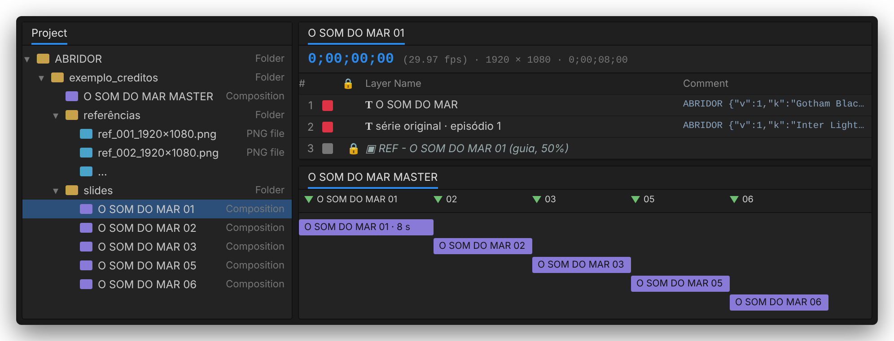
  <br><sub><i>ilustração: o que o ABRIDOR cria no projeto — uma comp por página, a comp master em sequência e as referências.</i></sub>
</p>

<br>

## 📑 índice

1. [instalar](#1--instalar)
2. [abrir o painel](#2--abrir-o-painel)
3. [abrir o documento](#3--abrir-o-documento)
4. [escolher as páginas](#4--escolher-as-páginas)
5. [configurar as comps](#5--configurar-as-comps)
6. [associar as fontes](#6--associar-as-fontes)
7. [criar as comps](#7--criar-as-comps)
8. [trocar as fontes depois](#8--trocar-as-fontes-depois)
9. [dicas e problemas comuns](#-dicas-e-problemas-comuns)
10. [como os textos são recriados](#-como-os-textos-são-recriados)
11. [idiomas e traduções](#-idiomas-e-traduções)

> 📂 **arquivos:**\
> • **INSTALAR O ABRIDOR.jsx** → instalador (roda dentro do After Effects).\
> • **abridor-cep/** → a extensão (painel CEP).\
> • **instalar_windows.bat** / **instalar_mac.command** → instaladores alternativos, sem abrir o After Effects.\
> • **test files/exemplo_creditos.pptx** → PPTX de exemplo para testar (é o usado nos prints abaixo).

<br>

---

<br>

## 1 · instalar

> ✅ **requisitos:** After Effects **2020 (17.0)** ou mais novo. recomendado o **2024 (24.3)** ou mais novo — veja a [tabela de versões](#-versões-do-after-effects).

**1.1** no After Effects, abra `File` > `Scripts` > `Run Script File...` e escolha o **INSTALAR O ABRIDOR.jsx** direto da pasta do ABRIDOR (a pasta que tem a `abridor-cep` dentro).

**1.2** o instalador confere sozinho o que é necessário. **se estiver tudo certo**, ele já abre com as boas-vindas, o aviso *✓ tudo certo!* e o botão **instalar** (ou **atualizar** / **reinstalar**, se já houver uma versão no computador; **remover** desinstala). a tela mostra de onde a extensão vai ser copiada e para onde.

<table>
  <tr>
    <td align="center">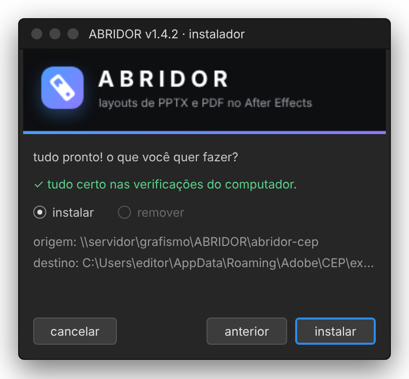<br><sub>1.2 · tudo certo: é só instalar</sub></td>
  </tr>
</table>

**1.3** se algo precisar de atenção, o instalador abre com as boas-vindas — clique em **começar** — e mostra a checagem: bolinha 🟢 = ok, 🟡 = funciona com limitações, 🔴 = precisa resolver. se a escrita de arquivos estiver bloqueada, use o link **› abrir preferências de scripts e expressões**, marque *Allow Scripts to Write Files and Access Network* e clique em **› verificar de novo**. depois, **próximo** leva à mesma escolha de instalar / atualizar.

<table>
  <tr>
    <td align="center">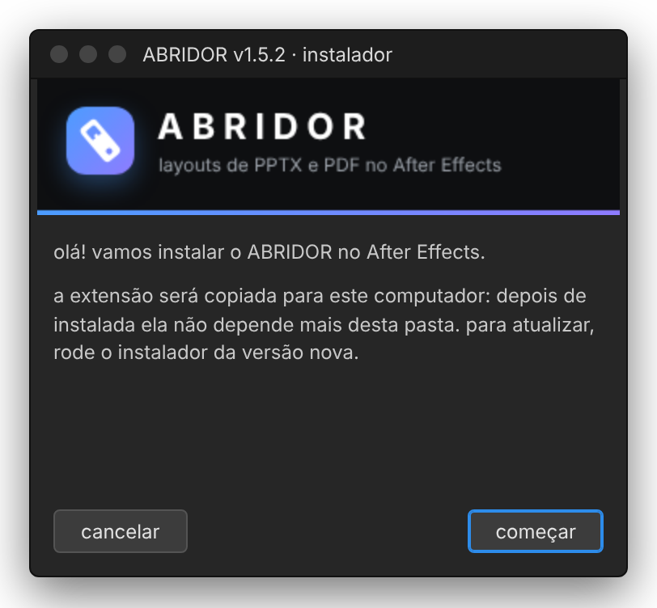<br><sub>1.3 · boas-vindas</sub></td>
    <td align="center">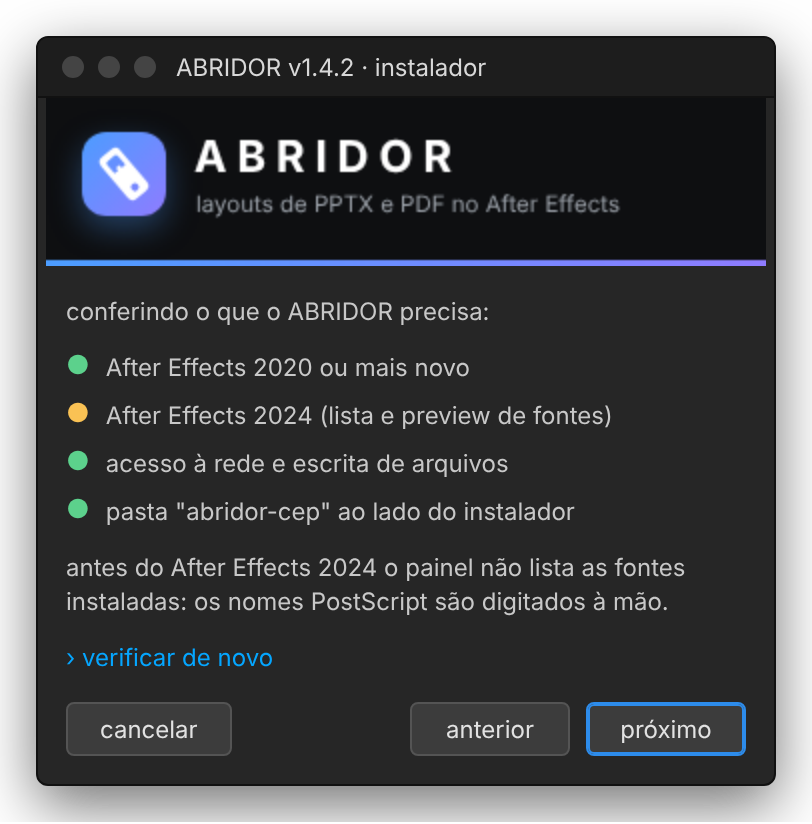<br><sub>1.3 · checagem</sub></td>
  </tr>
</table>

**1.4** pronto! **reinicie o After Effects**.

<table>
  <tr>
    <td align="center">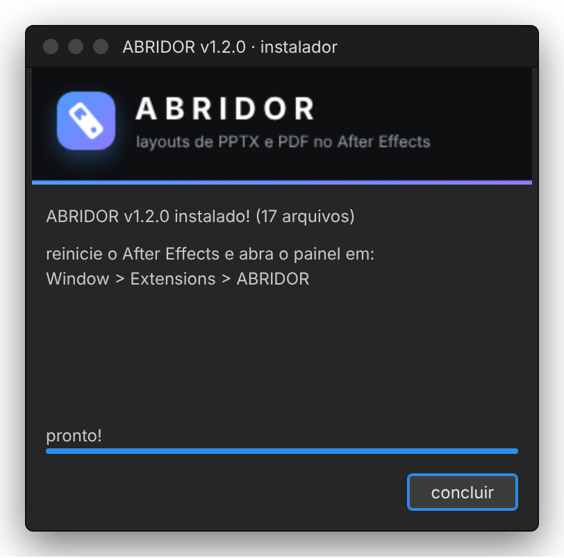<br><sub>1.4 · concluído</sub></td>
  </tr>
</table>

<sub><i>ilustrações da janela do instalador.</i></sub>

> 🚩 *obs:*\
> • a instalação é **sempre local**: a pasta `abridor-cep` inteira é copiada para a pasta de extensões do usuário. depois disso o ABRIDOR não depende mais da pasta de origem (rede, pendrive ou download). para atualizar, rode o instalador da versão nova.\
> • a extensão não é assinada, por isso o instalador habilita o `PlayerDebugMode` do CEP.\
> • **macOS:** se o painel não aparecer depois de reiniciar o After Effects, reinicie o computador.

<br>

---

<br>

## 2 · abrir o painel

**2.1** no After Effects, abra `Window` > `Extensions` > `ABRIDOR`. o painel pode ser encaixado em qualquer lugar da área de trabalho, como os outros painéis.

<p align="center">
  <br>
  <sub><i>ilustração do menu do After Effects.</i></sub>
</p>

**2.2** o painel abre pronto para receber um documento:

<table>
  <tr>
    <td width="400"></td>
    <td>

1. **clique** na área ou **arraste** um `.pptx` / `.pdf` para dentro do painel (atalho: `Ctrl/Cmd + O`).
2. **abas** → `páginas`, `comps` e `fontes`.
3. **criar comps** → fica ativo depois de abrir um documento.

  </td>
  </tr>
</table>

<p align="center">
  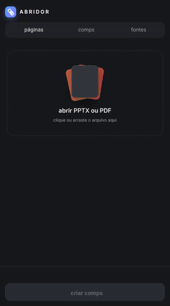<br>
  <sub>o painel em ação: seleção de páginas, duração, formato, fontes e criação.</sub>
</p>

**2.3** na primeira vez que você abre um documento, o painel oferece um **tour guiado** de 5 passos, usando o próprio documento: páginas, duração, formato, fontes e o botão de criar. `→` / `Enter` avançam, `←` volta, `Esc` pula. para rever depois, clique no **?** no topo.

<table>
  <tr>
    <td align="center"><br><sub>boas-vindas</sub></td>
    <td align="center">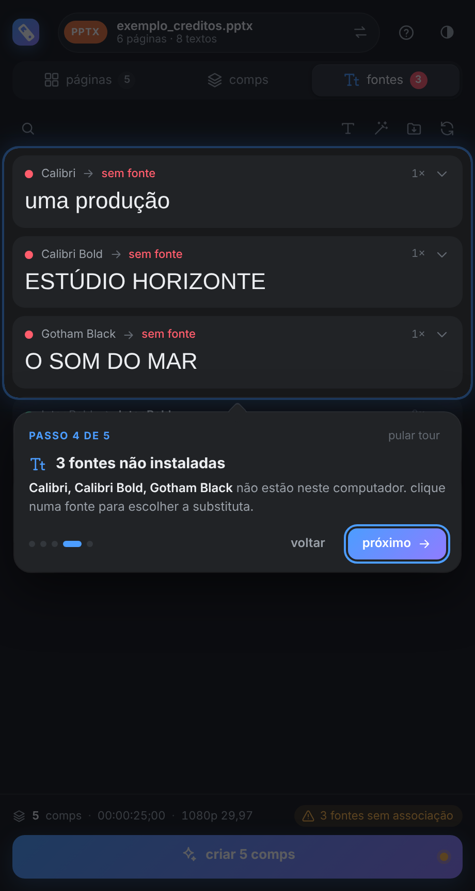<br><sub>passo 4: as fontes que faltam neste documento</sub></td>
  </tr>
</table>

**2.4** passe o mouse sobre qualquer botão para ver o **tooltip**: o que ele faz e, quando houver, o atalho de teclado. nas miniaturas, o tooltip lista os textos encontrados na página.

<p align="center">
  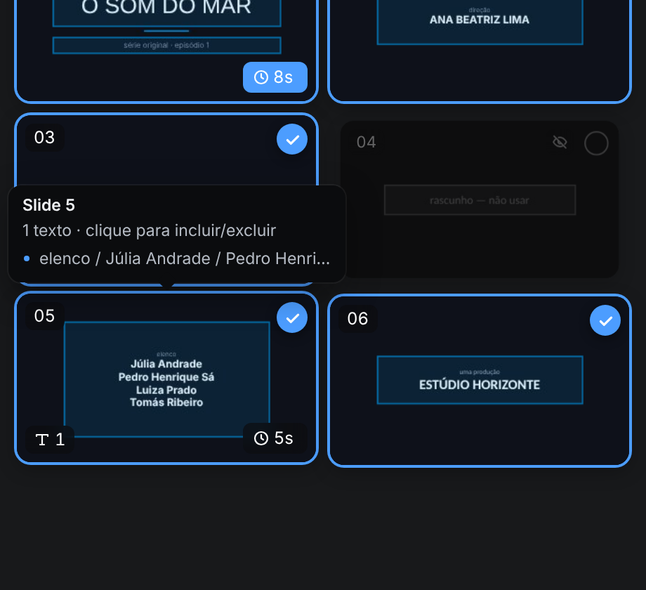
</p>

atalhos: `Ctrl/⌘ + O` abre um documento · `1` `2` `3` trocam de aba · `Ctrl/⌘ + Enter` cria as comps · `↑` `↓` mudam a duração.

**2.5** o painel tem **tema claro e escuro**. o botão no canto superior direito alterna entre:

<p align="center">
  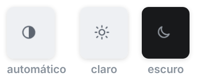
</p>

- **automático** (padrão) → segue o brilho da interface do After Effects (`Preferences` > `Appearance`) e muda junto se você ajustar o AE;
- **claro** ou **escuro** → fixo, independente do After Effects.

<table>
  <tr>
    <td align="center">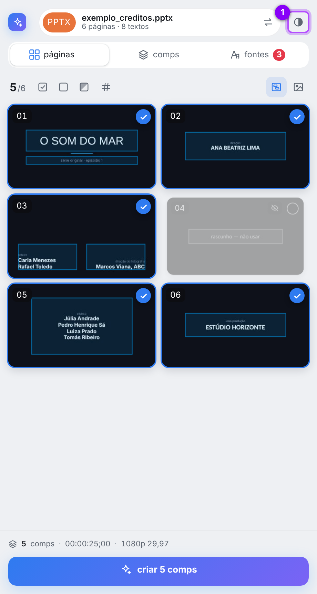<br><sub>tema claro: páginas</sub></td>
    <td align="center"><br><sub>tema claro: fontes</sub></td>
  </tr>
</table>

**2.6** o botão **PT** ao lado do tema troca o idioma do painel: **português → English → español**. a troca é na hora, sem fechar o documento aberto, e fica guardada. na primeira vez, o painel segue o idioma do After Effects. veja [idiomas e traduções](#-idiomas-e-traduções) para corrigir textos ou acrescentar outro idioma.

<br>

---

<br>

## 3 · abrir o documento

**3.0** a tela vazia lista os **documentos recentes**: clique para reabrir. arquivos que mudaram de lugar aparecem apagados (o **×** tira da lista; **limpar** esvazia a lista sem apagar arquivos).

<p align="center">
  
</p>

**3.1** cada página aparece em miniatura, com os textos detectados destacados por cima.

<table>
  <tr>
    <td align="center">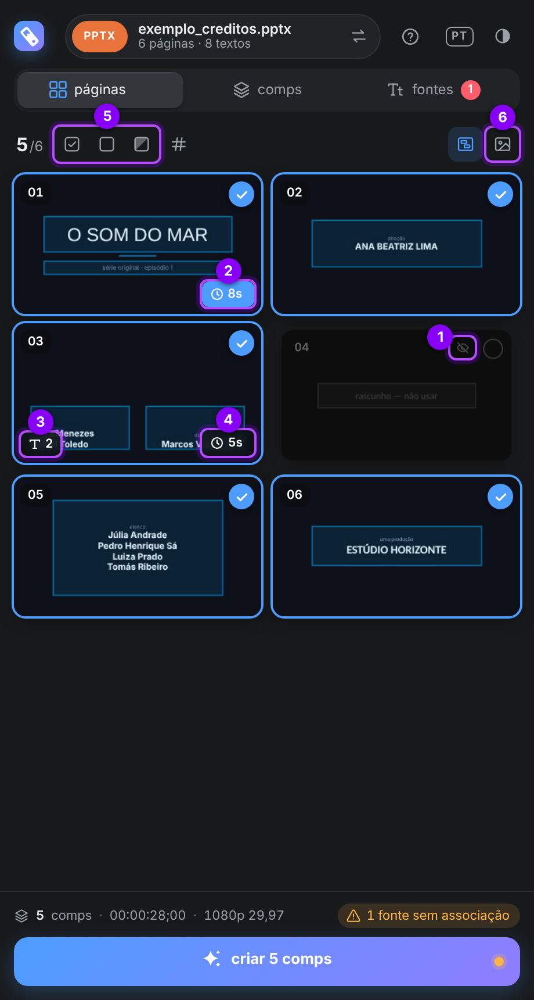<br><sub>PPTX: <code>exemplo_creditos.pptx</code></sub></td>
    <td align="center">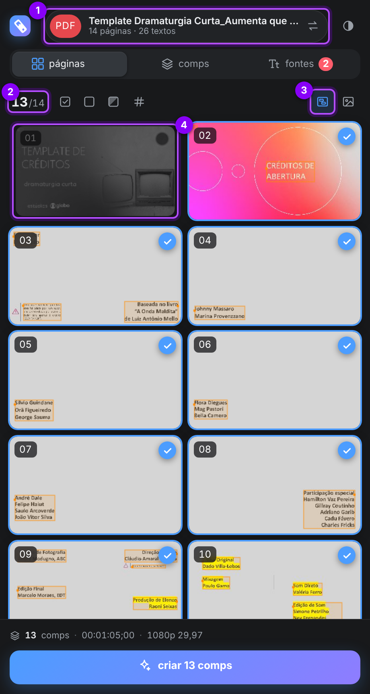<br><sub>PDF: template de créditos</sub></td>
  </tr>
</table>

no **PPTX** (à esquerda):

1.  slides **ocultos** no PowerPoint já vêm **desmarcados**.
2.  **duração desta página** → em azul quando foi alterada (aqui, 8 s).
3.  **textos encontrados** na página (aparece ao passar o mouse).
4. a duração padrão também aparece ao passar o mouse — clique para mudar.
5. seleção rápida: **todas**, **nenhuma** e **inverter**.
6.  **imagens externas** → usa PNG/JPG exportados do PowerPoint como referência (ver [dicas](#-dicas-e-problemas-comuns)).

no **PDF** (à direita):

1. o documento aberto. clique nele para **trocar de documento**.
2. páginas selecionadas / total.
3.  liga/desliga o destaque dos textos: 🟦 **azul** = caixa de texto, 🟧 **laranja** = texto de ponto.
4. a página 1 foi **desmarcada** com um clique: o título dela é uma **imagem** dentro do PDF (só o "globo" é texto).

**3.2** cada destaque vira **uma camada de texto**. abaixo, a mesma detecção em tamanho grande, com a fonte, o tamanho e o alinhamento que o ABRIDOR leu de cada bloco:

<p align="center">
  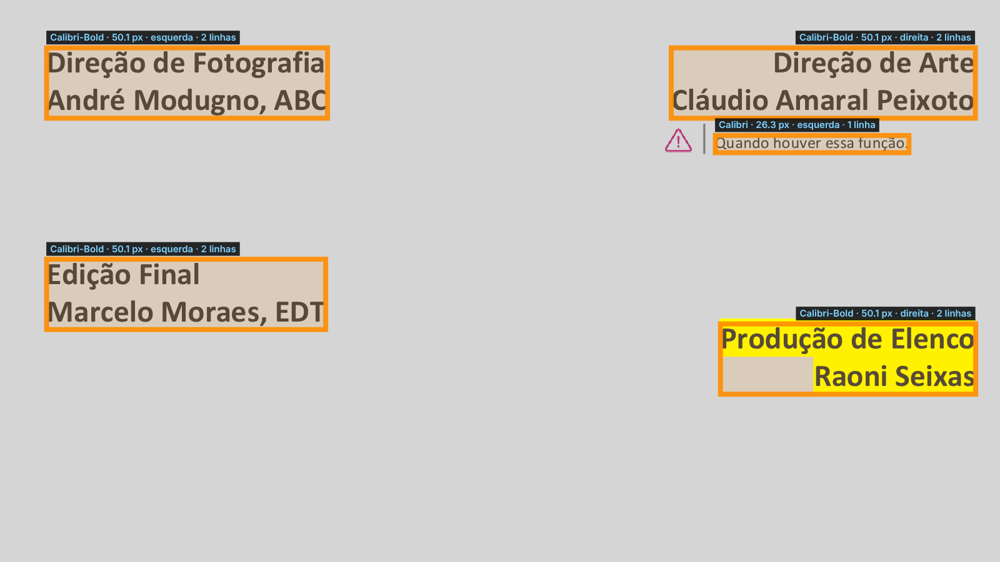<br>
  <sub>PDF: blocos à esquerda e à direita detectados pela geometria das linhas, com a fonte e o tamanho exatos de cada um.</sub>
</p>

<table>
  <tr>
    <td align="center">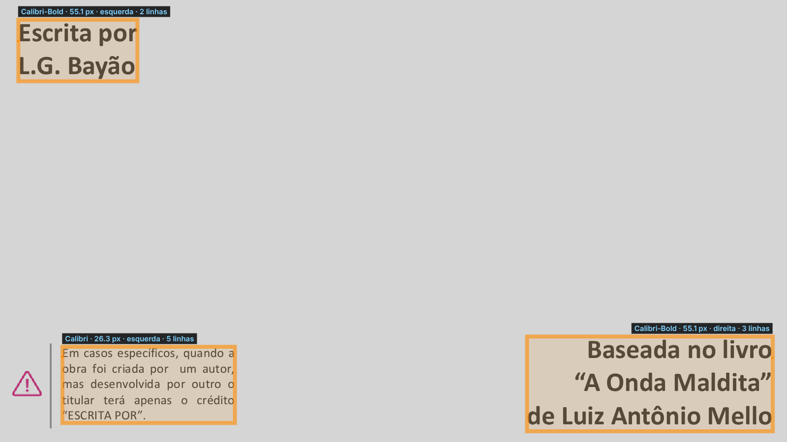<br><sub>PDF: parágrafos de várias linhas agrupados em uma camada.</sub></td>
    <td align="center"><br><sub>PPTX: caixas do PowerPoint (alinhadas na base, à esquerda e à direita).</sub></td>
  </tr>
</table>

<br>

---

<br>

## 4 · escolher as páginas

**4.1** clique na **miniatura** para incluir ou excluir a página: a selecionada ganha borda azul e ✔; a excluída fica apagada e não vira comp.

segure **shift** e clique em outra miniatura para marcar ou desmarcar **todo o intervalo** entre as duas. com o shift pressionado, o painel já mostra o intervalo antes do clique:

<p align="center">
  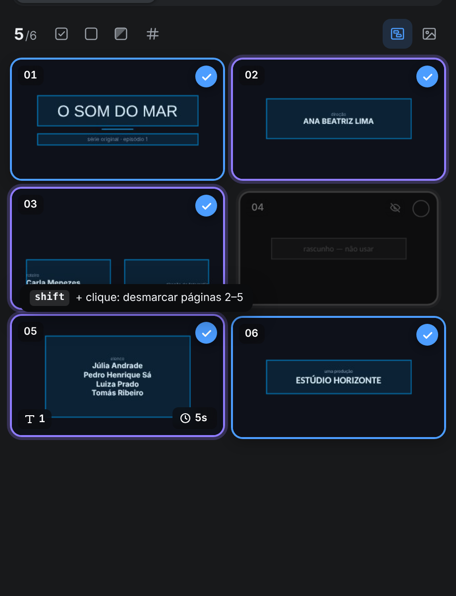
</p>

**4.2** para mudar a **duração de uma página**, clique no relógio, digite os segundos (aceita vírgula: `6,5`) e tecle `Enter`. deixe vazio para voltar à duração padrão; `Esc` cancela.

<p align="center">
  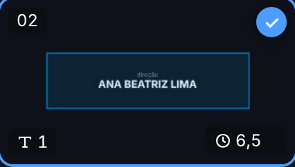
</p>

**4.3** para seleções maiores, use o **intervalo** :

<table>
  <tr>
    <td width="400">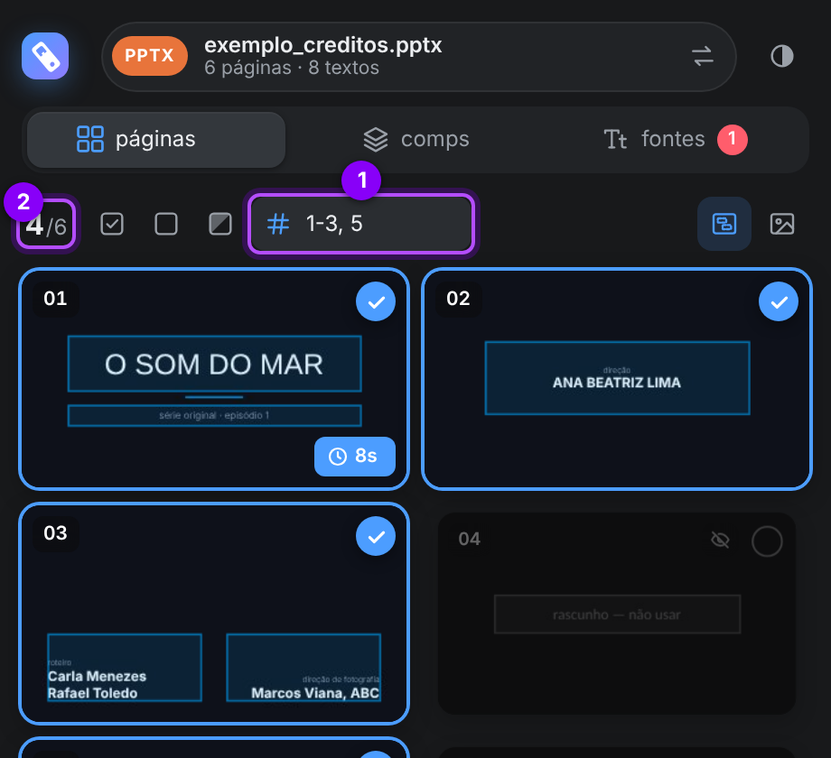</td>
    <td>

1. clique no `#` e digite as páginas, depois `Enter` (ou só clique fora do campo):
   - `1-3, 5` → páginas 1, 2, 3 e 5
   - `8-` → da 8 até o fim
   - `-4` → da 1 até a 4
2. ficam selecionadas **somente** essas páginas.
3. o **×** no fim do campo apaga o texto.

  </td>
  </tr>
</table>

<br>

---

<br>

## 5 · configurar as comps

**5.1** na aba **comps**:

<table>
  <tr>
    <td width="400">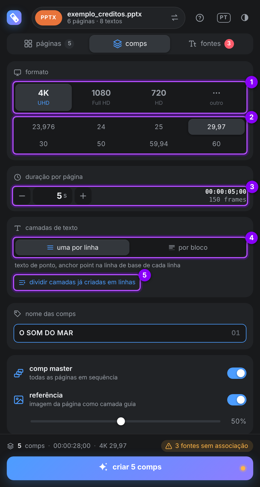</td>
    <td>

1. **formato** → `4K` (3840 × 2160), `1080` (1920 × 1080), `720` (1280 × 720) ou `···` para um tamanho personalizado.
2. **frame rate** → padrão **29,97**.
3. **duração por página** → `−` / `+` de 0,5 s (ou digite; `↑` `↓` também funcionam). ao lado, o timecode e os frames.
4. **camadas de texto**:
   - **uma por linha** (padrão) → cada linha vira uma camada de **texto de ponto**, com o **anchor point em [0, 0] na linha de base**, no ponto de alinhamento (início, centro ou fim da linha). nada é cortado se a fonte nova for mais larga.
   - **por bloco** → uma camada por caixa de texto do PowerPoint (*paragraph text*) ou por parágrafo do PDF.
5. **dividir camadas já criadas em linhas** → o mesmo resultado do modo *uma por linha*, aplicado depois (ver [passo 7.5](#7--criar-as-comps)).

o rodapé resume tudo: quantidade de comps, duração total, formato e frame rate.

  </td>
  </tr>
</table>

**5.2** mais abaixo e em **ajustes finos**:

<table>
  <tr>
    <td width="400">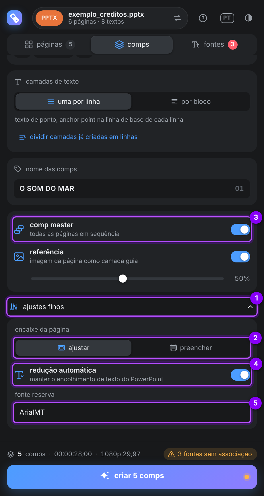</td>
    <td>

1. abre / fecha os ajustes finos.
2. **encaixe da página** → *ajustar* (página inteira visível) ou *preencher* (corta as bordas) quando a proporção do documento for diferente da comp.
3. **comp master** → todas as páginas em sequência, com um marcador por página.<br>**referência** → imagem da página como **camada guia** travada; ao ligar, aparece a opacidade.
4. **redução automática** (PPTX) → mantém o encolhimento de texto que o PowerPoint aplica quando o texto não cabe na caixa.
5. **fonte reserva** → nome PostScript usado quando uma fonte não estiver associada (padrão `ArialMT`).

  </td>
  </tr>
</table>

> 🚩 *obs:*\
> • as configurações ficam salvas para a próxima vez.\
> • camadas guia não aparecem no render final, nem quando a comp é usada como precomp.

<br>

---

<br>

## 6 · associar as fontes

**6.1** a aba **fontes** lista cada fonte do documento como **origem → destino**, com uma prévia do texto na fonte de destino. o número vermelho na aba indica quantas ainda **não têm fonte**.

<table>
  <tr>
    <td width="400"></td>
    <td>

1. **3 fontes sem associação** (o documento usa *Gotham Black* e *Calibri*, que não estão instaladas).
2. 🔴 **sem fonte** → se continuar assim, a camada usa a **fonte reserva**. as que faltam ficam no topo da lista.
3. 🟢 **automático** → *Inter Bold* do PowerPoint foi encontrada e associada sozinha. 🔵 = escolhida por você.
4. **prévia** com o texto do próprio documento, na fonte de destino.
5.  **associar automaticamente** de novo.
6.  **ler do projeto** (ver [passo 8](#8--trocar-as-fontes-depois)).

  </td>
  </tr>
</table>

**6.2** clique numa fonte para **abrir** e trocar:

<table>
  <tr>
    <td width="400"></td>
    <td>

exemplo: *Gotham Black* não está instalada → trocada por **Inter Black**:

1. clique na linha para abrir (clique de novo, ou em outra fonte, para fechar).
2. **família** → clique e digite para buscar (`Inter`). veja o [seletor de fontes](#-seletor-de-fontes) abaixo.
3. **estilo** → `Black` (ao trocar a família, o estilo mais parecido com o original já vem escolhido).
4. **escala** → `−` / `+` de 5 %. aqui `95 %`: a fonte nova é um pouco mais larga.
5. o texto na fonte **original** (se estiver instalada), para comparar.

as *Calibri* foram associadas à **Carlito**, que tem as mesmas medidas.

  </td>
  </tr>
</table>

#### 🔎 seletor de fontes

<table>
  <tr>
    <td width="400"></td>
    <td>

- digite parte do nome para filtrar; cada fonte aparece **desenhada nela mesma**;
- **sugestão** → fonte instalada com as **mesmas medidas** da original (*Calibri → Carlito*, *Cambria → Caladea*, *Arial → Liberation Sans*…);
- **recentes** → as últimas famílias escolhidas ficam no topo;
- `↑` `↓` navegam, `Enter` escolhe, `Esc` fecha.

  </td>
  </tr>
</table>

depois de trocar uma fonte, se o documento tiver **outros estilos da mesma família** (ex. *Calibri* e *Calibri Bold*), o painel oferece trocar todos de uma vez, mantendo o peso de cada um:

<p align="center">
  
</p>

**6.3** para comparar com outro texto (acentos, números…), clique em  (1), digite o **texto do preview** (2) e ajuste o **tamanho** (3):

<p align="center">
  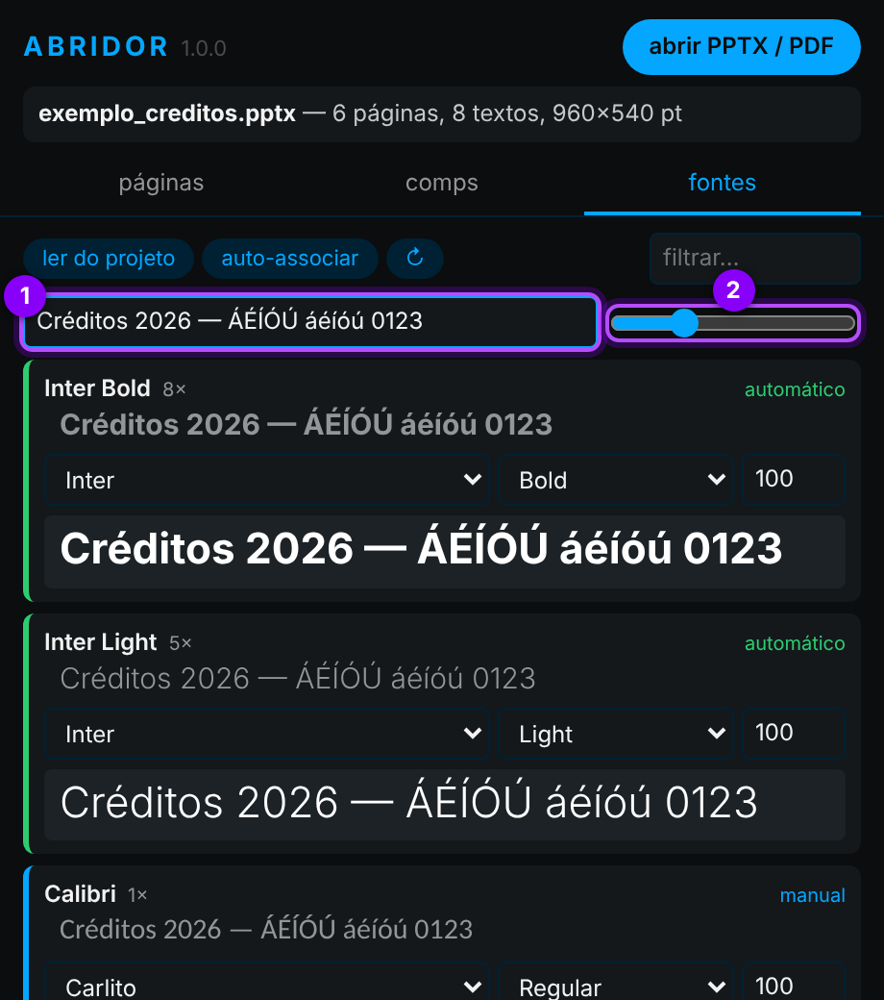
</p>

**6.4** a lista acompanha as **páginas selecionadas**. uma fonte que só aparece em páginas desmarcadas desce para o grupo recolhido **não usadas nas páginas selecionadas**, no fim da lista. ela não entra no aviso vermelho da aba e a associação dela fica guardada. marque a página de novo e a fonte volta para o lugar dela. clique no grupo para ver as fontes que estão lá.

> 💡 *dicas:*\
> • as escolhas manuais ficam **memorizadas**: no próximo documento com a mesma fonte, a associação já vem pronta.\
> •  recarrega a lista de fontes instaladas (útil depois de ativar uma fonte no Adobe Fonts).\
> •  filtra pelo nome da fonte do documento.

<br>

---

<br>

## 7 · criar as comps

**7.1** antes de criar, o painel avisa o que pode dar errado. se alguma fonte usada nas páginas selecionadas está sem associação, o rodapé mostra **⚠ N fontes sem associação** e o botão ganha um ponto laranja. clique no aviso para ir direto à fonte que falta:

<p align="center">
  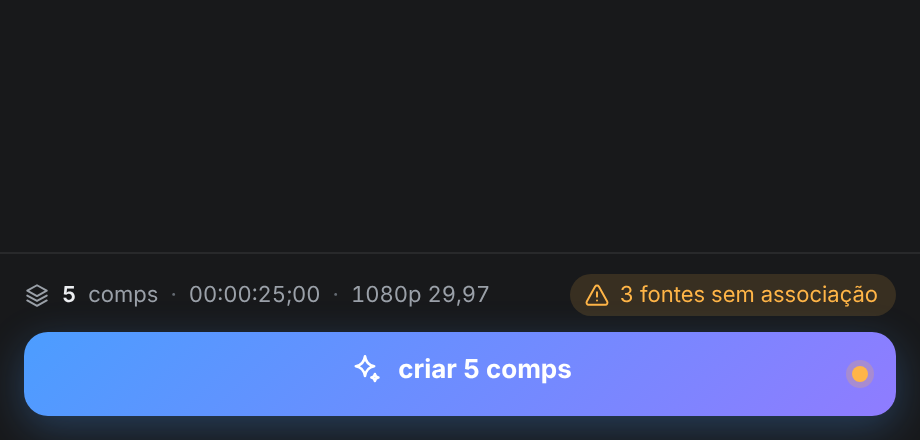
</p>

ao clicar em **criar**, se houver algo a decidir, sobe a folha **antes de criar**:

<table>
  <tr>
    <td width="400">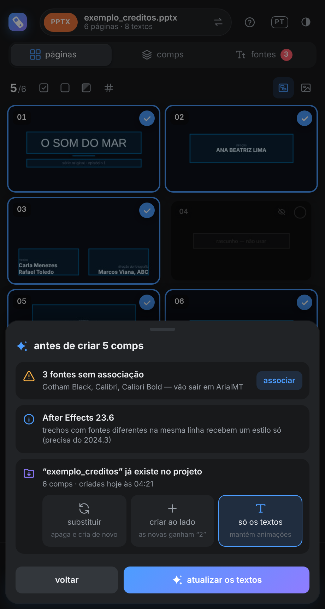</td>
    <td>

- ⚠ **fontes sem associação** → quais são e em que fonte vão sair. **associar** leva para a aba fontes, já com a primeira aberta.
- ⓘ **versão do After Effects** → só aparece se o AE for anterior ao 2024 (24.3) e o documento tiver trechos com fontes diferentes na mesma linha.
- 📁 **o documento já existe no projeto** → escolha:
  - **só os textos** (padrão) → mantém as comps, posições, animações e efeitos e troca só o **conteúdo** das camadas de texto. textos novos viram camadas novas; camadas que perderam o texto ficam e aparecem nos avisos;
  - **criar ao lado** → mantém as antigas; as novas vão para a pasta “nome 2” e as comps ganham “(2)”;
  - **substituir** → apaga a pasta e as comps antigas do documento e cria de novo.

`Enter` confirma, `Esc` volta. sem nada a decidir, o botão cria direto.

  </td>
  </tr>
</table>

**7.2** clique em **criar N comps** (ou **atualizar os textos**). o próprio botão vira a barra de andamento:

<p align="center">
  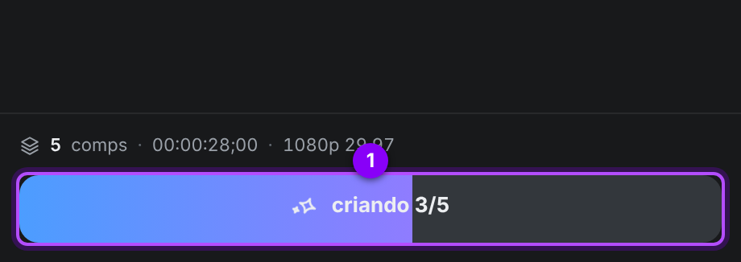
</p>

**7.3** no fim, o botão fica verde com um ✔, e uma mensagem confirma quantas comps foram criadas (1). se houver **avisos**, aparece o ⚠ com a quantidade (2):

<p align="center">
  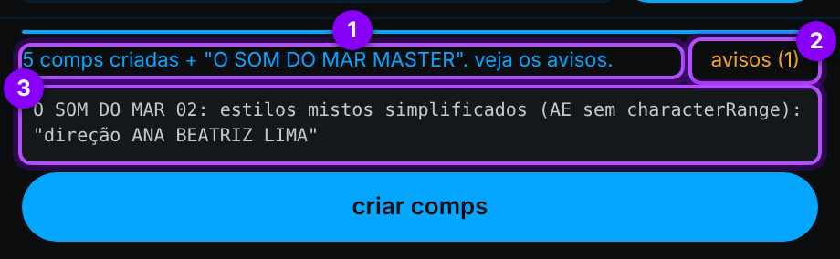
</p>

o aviso final tem atalhos para **abrir master** e **mostrar no projeto** (seleciona a pasta do documento no painel *Project*):

<p align="center">
  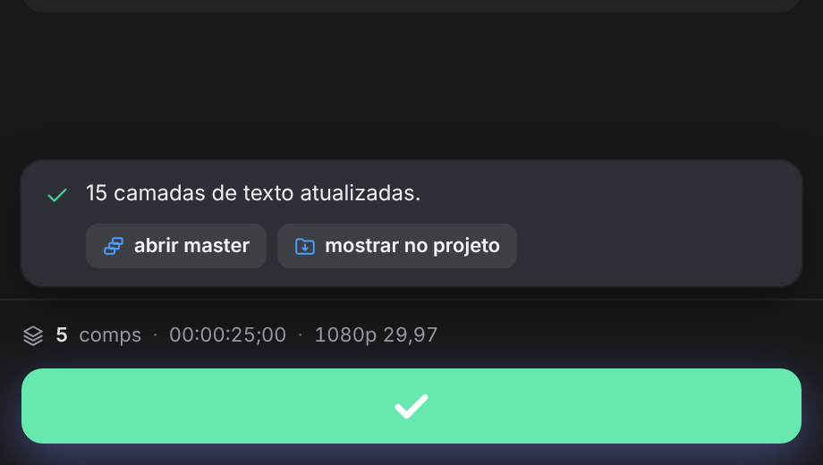
</p>

clique no ⚠ para ver a lista:

<p align="center">
  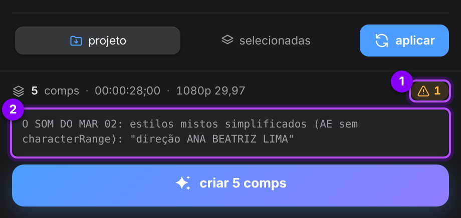
</p>

avisos comuns:
- `fonte "X" indisponível (…) → ArialMT` → a fonte escolhida não está instalada nesta máquina e a camada usou a reserva;
- `estilos mistos simplificados` → a camada tem fontes/tamanhos diferentes, mas a versão do After Effects é anterior à 2024 (24.3), então recebeu um estilo só.

**7.4** no projeto, o ABRIDOR cria:

```
📁 ABRIDOR
 └─ 📁 exemplo_creditos            ← uma pasta por documento
     ├─ 🎞 O SOM DO MAR MASTER      ← todas as páginas em sequência, com marcadores
     ├─ 📁 referências              ← imagens das páginas (PNG)
     └─ 📁 slides
         ├─ 🎞 O SOM DO MAR 01      ← uma comp por página selecionada
         ├─ 🎞 O SOM DO MAR 02
         └─ …
```

em cada comp de página: as **camadas de texto**, com o nome do próprio texto, e por baixo a **REF**, a camada guia travada com a imagem da página (veja a [ilustração no topo](#-abridor)).

**7.5** para dividir em linhas camadas que já existem (criadas *por bloco*, por uma versão anterior do ABRIDOR ou até digitadas à mão):

1. selecione as **camadas de texto** na comp ativa — ou selecione **comps** no painel *Project* para dividir todas as camadas de texto delas;
2. na aba **comps**, clique em **dividir camadas já criadas em linhas**.

cada linha vira uma camada de texto de ponto com o anchor point zerado na linha de base, no mesmo lugar, com as mesmas cores, fontes, escala, rotação, pai e tempo. camadas com keyframes ou expressão no texto são puladas (aparecem nos avisos). `Edit` > `Undo` desfaz tudo de uma vez.

> 🚩 *obs:*\
> • as imagens de referência são salvas numa pasta `<nome do documento>_ABRIDOR` ao lado do documento (ou na pasta temporária, se não for possível gravar lá ou se o arquivo foi arrastado sem caminho conhecido).\
> • cada etapa pode ser desfeita com `Edit` > `Undo`.\
> • a coluna **Comment** das camadas de texto guarda a fonte original (`ABRIDOR {...}`). **não apague** esse comentário se quiser trocar as fontes depois.

<br>

---

<br>

## 8 · trocar as fontes depois

as camadas criadas pelo ABRIDOR lembram a fonte original de cada trecho. por isso as fontes podem ser trocadas **a qualquer momento** — no mesmo dia ou meses depois, com o documento original ou sem ele.

**8.1** abra o projeto e vá na aba **fontes**. sem documento aberto, use **ler do projeto** (1):

<p align="center">
  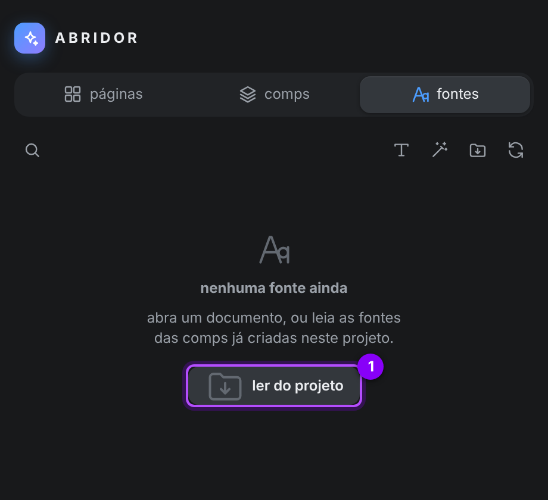
</p>

**8.2** aparecem as fontes das camadas já criadas, com o último mapeamento usado. troque o que quiser e aplique:

<table>
  <tr>
    <td width="400">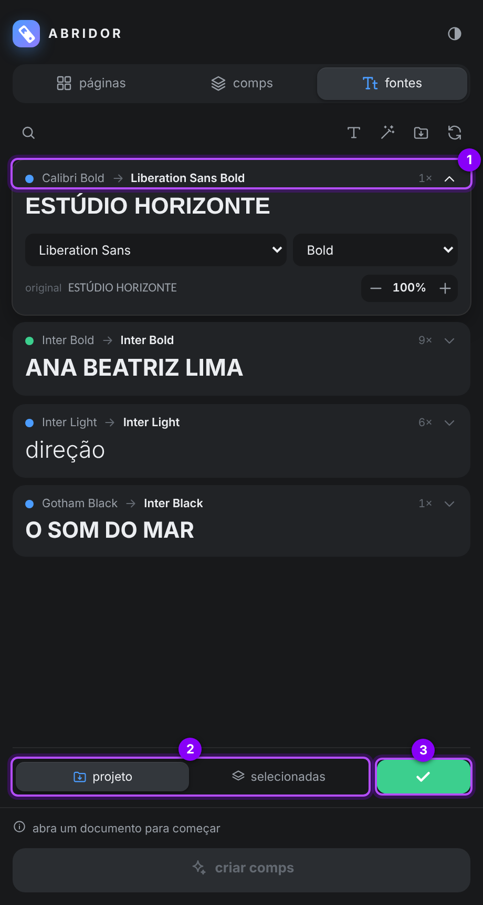</td>
    <td>

1. troque a fonte (aqui *Calibri Bold* → **Liberation Sans Bold**).
2. escolha onde aplicar:
   - **projeto** → em todas as comps do projeto;
   - **selecionadas** → só nas comps selecionadas no painel *Project*.
3. **aplicar** → o botão confirma com ✔ quando termina.

a barra **aplicar** só aparece quando há comps do ABRIDOR no projeto (depois de criar ou de ler do projeto).

  </td>
  </tr>
</table>

> 🚩 *obs:*\
> • a troca preserva os tamanhos ajustados à mão (exceto em camadas com fontes misturadas, que voltam ao tamanho original × escala).\
> • funciona também com keyframes de *Source Text*.

<br>

---

<br>

## 💡 dicas e problemas comuns

**o painel não aparece em `Window` > `Extensions`.**\
reinicie o After Effects depois de instalar. no macOS, reinicie também o computador. confira se a pasta `com.abridor.panel` existe em:
- Windows: `%APPDATA%\Adobe\CEP\extensions\`
- macOS: `~/Library/Application Support/Adobe/CEP/extensions/`

**uma página do PDF aparece com 0 textos (ou faltando textos).**\
o texto está como **imagem** ou foi convertido em **curvas** no PDF. não há como extrair: digite esse texto no After Effects ou peça o PPTX original.

**quero uma referência idêntica ao PowerPoint.**\
a referência de PPTX é um render aproximado (fundo, imagens, formas e textos). para ficar idêntica:
1. no PowerPoint, `Arquivo` > `Exportar` > `Alterar Tipo de Arquivo` > `PNG` (todos os slides);
2. no ABRIDOR, aba **páginas** > **imagens externas…** e escolha a pasta dos PNGs. as imagens são associadas pela ordem numérica dos arquivos (`Slide1.png`, `Slide2.png`, …) e as páginas ganham a etiqueta **IMG**. o **×** volta para a referência interna.

ou salve o PPTX como PDF e use o PDF.

**o texto ficou mais largo / quebrou em mais linhas que no documento.**\
a fonte substituta é mais larga que a original. ajuste a **escala** da fonte na aba **fontes** e aplique de novo. as caixas de texto são criadas com folga extra na altura para não cortar linhas.

**PDF: queria uma camada por linha.**\
aba **comps** > **textos** > *uma camada por linha*. o documento é relido na hora.

**PPTX: o texto está menor que no PowerPoint.**\
o PowerPoint reduz o texto quando ele não cabe na caixa (*redução automática*), e o ABRIDOR copia essa redução. para usar o tamanho original, desligue **redução automática** (*manter o encolhimento de texto do PowerPoint*) em **ajustes finos**, na aba **comps**.

### 📋 versões do After Effects

| recurso | versão mínima |
| --- | --- |
| painel, criação das comps, troca de fontes | **2020 (17.0)** |
| lista de fontes instaladas, associação automática e preview | **2024 (24.0)** — antes disso, digite o nome PostScript |
| fontes / tamanhos / cores diferentes **na mesma camada** | **2024 (24.3)** — antes disso, a camada usa o estilo predominante |

<br>

---

<br>

## 🔍 como os textos são recriados

| | **PPTX** | **PDF** |
| --- | --- | --- |
| tipo de camada | *uma por linha*: texto de ponto por linha, anchor na linha de base · *por bloco*: caixa de texto do tamanho da caixa do PowerPoint | *uma por linha*: texto de ponto por linha · *por bloco*: texto de ponto por parágrafo; anchor sempre na **linha de base** exata |
| alinhamento | horizontal (esq. / centro / dir. / justificado) e vertical (topo / meio / base) | detectado pela geometria das linhas |
| fonte / tamanho / cor | herdados de slide → layout → mestre → tema | nome PostScript embutido, tamanho e cor exata do PDF |
| entrelinha | modelo do PowerPoint: 1,2 × tamanho × espaçamento, 1ª linha de base a (entrelinha − 0,2 × tamanho) do topo, espaço antes/depois de parágrafo, alinhamento vertical da caixa (incl. redução automática) | distância medida entre as linhas |
| outros | rotação, grupos, tabelas, placeholders, maiúsculas, espaçamento entre letras | rotação, trechos com cores / fontes diferentes |

<br>

---

<br>

## 🌐 idiomas e traduções

o painel, as mensagens do After Effects e o instalador estão em **português**, **English** e **español**.

- **no painel:** o botão **PT / EN / ES** no topo troca o idioma na hora, sem perder o documento aberto. a escolha fica guardada. na primeira vez, o painel usa o idioma do After Effects (se não for nenhum dos três, usa o inglês).
- **no instalador:** segue o idioma do After Effects.

todos os textos ficam num arquivo só: **`abridor-cep/i18n/strings.csv`** — uma linha por texto, uma coluna por idioma. dá para abrir no Excel, no Google Sheets ou num editor de texto:

```
key,pt,en,es
app.cta.createAll,criar comps,create comps,crear comps
app.pages.one,{n} página,{n} page,{n} página
app.pages.other,{n} páginas,{n} pages,{n} páginas
```

- **corrigir uma tradução:** edite a célula na pasta do ABRIDOR e rode o instalador de novo (ou edite direto o `strings.csv` da extensão instalada) e reabra o painel.
- **novo idioma:** acrescente uma coluna com o código de 2 letras (ex.: `fr`) e preencha. ela já aparece no botão de idioma e no instalador. célula vazia usa o português.
- `{nome}` é trocado por um valor (número de páginas, nome da fonte…) — mantenha igual em todas as colunas.
- chaves terminadas em `.one` / `.other` são singular e plural.
- `\n` é quebra de linha; linhas começando com `#` são comentários.
- o separador pode ser vírgula ou ponto e vírgula (o Excel em português costuma salvar com `;`). salve sempre em **UTF-8**.

> ⚠️ *obs:* os prefixos indicam onde o texto aparece: `panel.*` e `app.*` no painel, `tour.*` no tour guiado, `err.*` / `parser.*` em erros e nomes de página, `host.*` nos avisos e no histórico de desfazer do After Effects, `inst.*` no instalador.

<br>

---

<br>

## 🛠 desenvolvimento

```
abridor-cep/
├── CSXS/manifest.xml     → manifesto CEP (AEFT 17+)
├── index.html            → interface
├── css/style.css
├── js/
│   ├── i18n.js           → traduções (lê i18n/strings.csv)
│   ├── cep.js            → ponte com o AE (evalScript) e sistema de arquivos (Node)
│   ├── ui.js             → ícones, animações de expandir/recolher, segmentados, toasts
│   ├── pptx-parser.js    → leitura do PPTX (zip + XML)
│   ├── pdf-parser.js     → leitura do PDF (pdf.js)
│   ├── render.js         → miniaturas / referência de PPTX
│   ├── fonts.js          → fontes instaladas, associação automática, preview
│   ├── app.js            → lógica do painel
│   └── lib/              → JSZip 3.10.1, pdf.js 3.11.174 (legacy)
└── jsx/host.jsx          → criação das comps e troca de fontes (ExtendScript)
```

- depuração: com o painel aberto no AE, acesse `http://localhost:8099` no Chrome (arquivo `.debug`).
- testes fora do After Effects (Node + Playwright):
  - todos os testes de painel aceitam `ABR_LANG=en` ou `ABR_LANG=es` (padrão `pt-BR`), ex.: `ABR_LANG=en node tests/run_panel.js …`. o `tests/pw.js` prepara o Playwright (idioma e acesso ao CSV).
  - `node tests/run_panel.js <arquivo.pptx|pdf> <saída>` → abre o painel no Chromium com o AE simulado, extrai e gera o job.
  - `node tests/host_mock.js <saída>/job.json <saída>/host` → executa o `host.jsx` contra um mock do After Effects e desenha as camadas sobre a referência.
  - `node tests/tour_check.js <saída>` → verifica o tour guiado: primeira vez, passos, teclado, botão **?** e tour sem documento (com `--docs`, grava os prints do README).
  - `node tests/features_check.js <saída>` → verifica no painel a checagem antes de criar, o seletor de fontes, a troca da família, o shift+clique, as ações no fim e os recentes (com `--docs`, grava os prints do README).
  - `MODES=new,texts,side,replace node tests/host_mock.js …` → roda os modos de criação em sequência no mock do After Effects.
  - `node tests/installer_mock.js <pasta temporária>` → executa o instalador com File/Folder/ScriptUI simulados (instala e remove).
  - `python3 tests/make_test_pptx.py <arquivo.pptx>` → gera um PPTX com casos variados.
- prints do README:
  - `python3 tests/make_example_pptx.py` → gera o `exemplo_creditos.pptx`.
  - `node tests/make_screenshots.js` → gera todos os prints de `docs/img` (painel real no Chromium com o AE simulado; instalador, menu e projeto são ilustrações em `tests/illustrations.html`).
  - `node tests/make_demo.js` → grava a animação `docs/img/demo.gif` (precisa do `ffmpeg`).
  - prints em outros idiomas: rode `make_screenshots.js`, `make_demo.js`, `features_check.js <saída> --docs` e `tour_check.js <saída> --docs` com `ABR_LANG=en` ou `ABR_LANG=es` → vão para `docs/img/en/` e `docs/img/es/` (mesmos nomes de arquivo).
  - `python3 tests/make_micro_css.py` → gera `css/micro.css`, as micro-interações de hover de cada ícone.
  - `node tests/micro_preview.js <saída>` → grava o catálogo das micro-interações e o painel em uso (GIFs, precisa do `ffmpeg`).
  - `node tests/make_banner.js` → gera o banner do instalador (com o logo) e grava a string ExtendScript no instalador.
- `js/lib/pdf.js` e `pdf.worker.js` têm uma alteração: `isNodeJS = false`, porque o CEP expõe `process` e o pdf.js tentaria usar APIs do Node.
